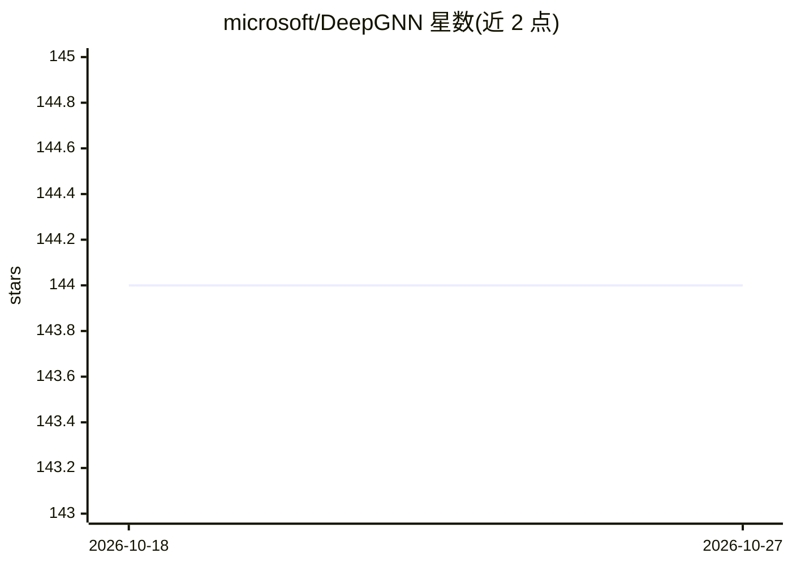

# microsoft/DeepGNN

⭐ 144 · Python · MIT · 推送 2026-10-01 · [GitHub](https://github.com/microsoft/DeepGNN) · 组织维护

**大规模图数据上训练 GNN 的分布式框架**

微软开源的图神经网络训练与推理框架：支持 CPU/GPU 上的分布式训练与推理、自定义 GNN 设计、在线采样（Graph Engine 加载全图数据，各训练 worker 从中获取节点/边/邻居特征与标签）以及自动图切分。提供 pip 包安装，可从源码构建；示例中演示在 cora 数据集上用 PyTorch 训练 graphsage。项目处于 alpha 版本，可能存在破坏性变更，并提供脚本迁移模块辅助升级。

## 筛选速览

| 维度 | 判定 | 备注 |
|---|---|---|
| AI 角色 | `ai-ecosystem` | LLM/agent 周边工具 |
| 许可风险 | `permissive` | MIT |
| 部署形态 | `library` | 以包/库形式分发 |
| 模型依赖 | — | README 未给出锁定关系 |
| 硬件要求 | — | 无带数字的原话,不猜 |
| 安装摩擦 | `low` | 无编译、无系统依赖或容器化 |
| 成熟度 | `idea` | |

## 能力要点

- CPU/GPU 分布式 GNN 训练与推理
- Graph Engine 在线采样：worker 实时获取节点/边/邻居特征
- 自动图切分
- 提供版本迁移模块辅助脚本升级

## 适用场景

- 在大规模图数据上分布式训练图神经网络
- 用 PyTorch 在 cora 等数据集上训练 graphsage
- 将旧版本 deepgnn 脚本迁移到新版本

## 场景标签

`模型训练` · 领域:训练与推理

## 证据(README 行号)

> L3: DeepGNN is a framework for training machine learning models on large scale graph data. DeepGNN contains all the nece
> L5: * Distributed GNN training and inferencing on both CPU and GPU.

## 星数曲线

2026-10-18 144 → 2026-10-27 144（+0）

---
*卡片 v1 · prompt 1.4 · 生成 2026-10-22 · 置信度 high · 依据 README sha `d4974d39b16b` · [字段定义](../../DATASET.md)*
