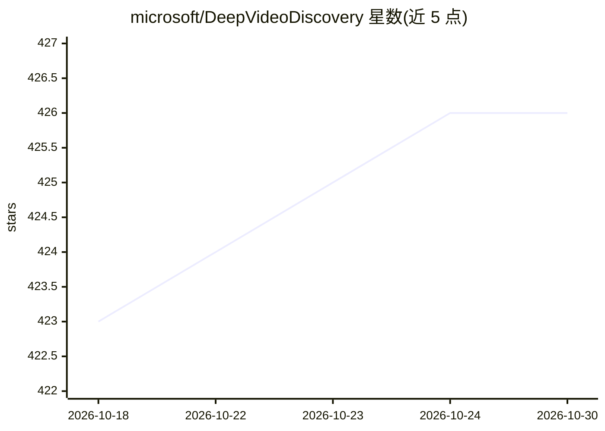

# microsoft/DeepVideoDiscovery

⭐ 426 · Python · MIT · 推送 2025-11-03 · [GitHub](https://github.com/microsoft/DeepVideoDiscovery) · 组织维护

**面向超长视频理解与问答的深度研究式 agent**

论文官方实现：Deep Video Discovery 是以 LLM 为核心的深度研究式问答 agent，用于理解超长视频并回答复杂问题。机制上把分段视频片段视为可探索环境，自主规划与推理，动态选择多粒度工具迭代提取信息，并对观察进行总结与反思。支持 OpenAI API 与 Azure OpenAI API，提供 lite_mode（仅用字幕的轻量版）与 Gradio 演示（Hugging Face Spaces）。安装方式为克隆仓库后 pip 安装依赖，通过 local_run.py 以 YouTube URL 加问题运行。

## 筛选速览

| 维度 | 判定 | 备注 |
|---|---|---|
| AI 角色 | `ai-native` | 本体是模型或模型工具 |
| 许可风险 | `permissive` | MIT |
| 部署形态 | `library` | 以包/库形式分发 |
| 模型依赖 | locked-api |  |
| 硬件要求 | — | 无带数字的原话,不猜 |
| 安装摩擦 | `low` | 无编译、无系统依赖或容器化 |
| 成熟度 | — | 结构信号不足 |

## 能力要点

- 把分段视频片段作为探索环境，自主规划与多粒度工具调用
- 支持 OpenAI API 与 Azure OpenAI API
- lite_mode 轻量版仅用字幕（适合播客类视频分析）
- 提供 Gradio 演示与自动字幕支持

## 适用场景

- 针对超长视频（如 YouTube 播客）提问并获得答案
- 在 LVBench、Video-MME 等长视频基准上复现实验
- 研究 agent 式视频检索与工具调用方法

## 场景标签

`多模态` · 领域:感知与多模态

## 证据(README 行号)

> L24: **Deep Video Discovery (DVD)** is a deep-research style question answering agent designed for understanding extra-l
> L34: - 🎬 **Treating segmented video clips as exploration environments**

## 星数曲线

2026-10-18 423 → 2026-10-30 426（+3）

---
*卡片 v1 · prompt 1.4 · 生成 2026-10-21 · 置信度 mid · 依据 README sha `7b1b48c0140c` · [字段定义](../../DATASET.md)*
