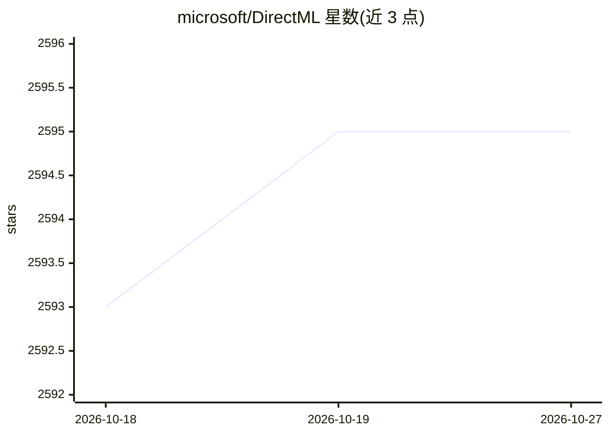

# microsoft/DirectML

⭐ 2,595 · C++ · MIT · 推送 2026-04-27 · [GitHub](https://github.com/microsoft/DirectML) · 组织维护

**微软 DirectX 12 GPU 加速机器学习运算库（维护模式）**

微软维护的基于 DirectX 12 的底层 GPU 加速库，为常见机器学习任务在 AMD/Intel/NVIDIA/Qualcomm 等所有支持 DirectX 12 的 GPU 上提供加速，面向高性能低延迟场景（框架、游戏、实时应用）。以 Windows 10 系统组件和独立 NuGet 分发包形式提供原生 C++ API；同时作为 Windows ML、ONNX Runtime 的 GPU 后端，并提供 torch-directml、tensorflow-directml 插件。仓库声明进入维护模式：不再新增功能，仅保留安全与合规修复，且示例不再更新；Windows 11 24H2 建议改用 Windows ML。

## 筛选速览

| 维度 | 判定 | 备注 |
|---|---|---|
| AI 角色 | `ai-native` | 本体是模型或模型工具 |
| 许可风险 | `permissive` | MIT |
| 部署形态 | `library` | 以包/库形式分发 |
| 模型依赖 | — | README 未给出锁定关系 |
| 硬件要求 | — | 无带数字的原话,不猜 |
| 安装摩擦 | `low` | 无编译、无系统依赖或容器化 |
| 成熟度 | — | 结构信号不足 |

## 能力要点

- 跨厂商支持所有 DirectX 12 GPU（AMD/Intel/NVIDIA/Qualcomm）
- 原生 C++ DirectX 12 API，随 Windows 10 1903+ 内置并有独立 NuGet 分发包
- 作为 Windows ML / ONNX Runtime 的 GPU 后端，提供 torch-directml 与 tensorflow-directml 插件
- 提供 DxDispatch 命令行工具免写 C++ 样板即可执行 DirectML 运算

## 适用场景

- 我在 Windows 上需要跨 GPU 厂商的机器学习推理加速
- 我为游戏或实时应用嵌入低延迟 ML 推理
- 我在无 CUDA 的 AMD/Intel GPU 上跑 PyTorch/ONNX 模型

## 场景标签

`推理引擎` · 领域:训练与推理

## 证据(README 行号)

> L10: DirectML is a high-performance, hardware-accelerated DirectX 12 library for machine learning. DirectML provides GPU
> L46: DirectML is built-in as a backend to several frameworks such as Windows ML, ONNX Runtime, and TensorFlow.

## 星数曲线

2026-10-18 2,593 → 2026-10-27 2,595（+2）

---
*卡片 v1 · prompt 1.4 · 生成 2026-10-21 · 置信度 mid · 依据 README sha `13854e0f01a6` · [字段定义](../../DATASET.md)*
