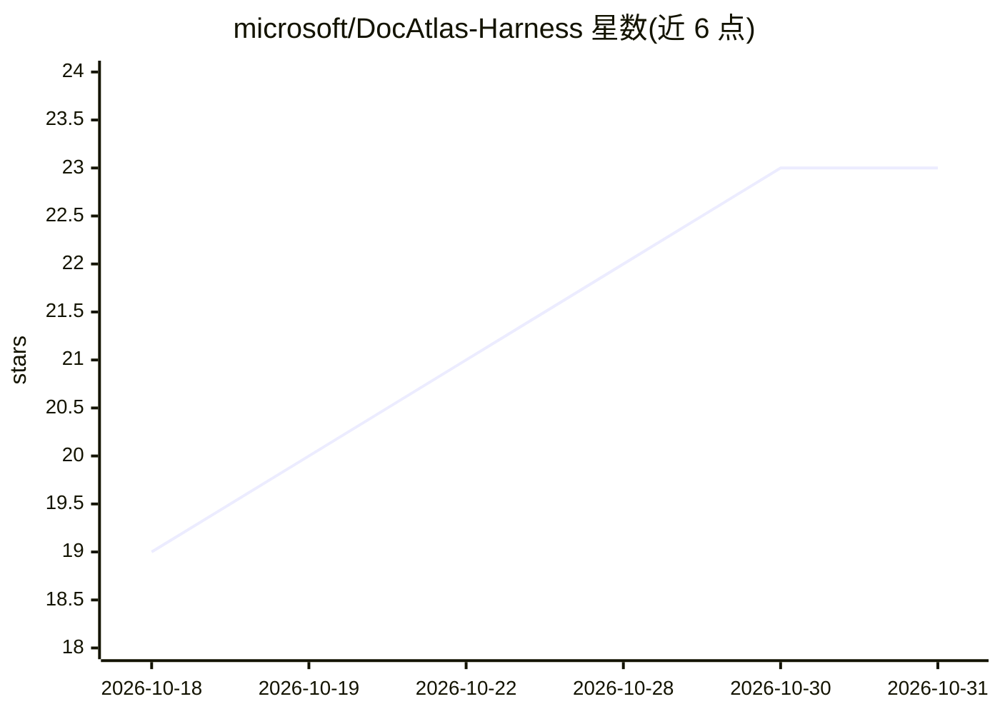

# microsoft/DocAtlas-Harness

⭐ 23 · TypeScript · MIT · 推送 2026-10-29 · [GitHub](https://github.com/microsoft/DocAtlas-Harness) · 组织维护 · 中文 README

**面向长篇多模态文档理解的开源 agent harness，供模型接入**

微软开源的模型无关 agent harness，把 PDF 集合转化为可变工作区：agent 通过 Search/Read/Note/Review 四个遵循 Agent Skills 规范的技能，检索文档树、选择性读取文本与页面图像、记录页锚定证据并回写状态，最终合成有出处的回答。提供交互式 TUI 与本地 Web UI（beta）、非交互 CLI 及单技能直跑入口。默认经 Azure OpenAI 部署访问模型；论文复现需 MinerU 2.5，本地可用 Docling 预处理。配套 XL-DocBench 基准，均被 NeurIPS 2026 接收。

## 筛选速览

| 维度 | 判定 | 备注 |
|---|---|---|
| AI 角色 | `ai-ecosystem` | LLM/agent 周边工具 |
| 许可风险 | `permissive` | MIT |
| 部署形态 | `None` |  |
| 模型依赖 | — | README 未给出锁定关系 |
| 硬件要求 | — | 无带数字的原话,不猜 |
| 安装摩擦 | `low` | 无编译、无系统依赖或容器化 |
| 成熟度 | `idea` | |

## 能力要点

- Search/Read/Note/Review 四技能驱动可变状态文档工作区，页锚定证据回写改进后续检索
- Agent Skills 元数据规范兼容，技能可独立于会话直接运行
- 提供交互式 TUI、本地 Web UI（beta）与非交互 CLI（含 --format json）
- 配套 XL-DocBench 基准，论文与基准均被 NeurIPS 2026 接收

## 适用场景

- 让接入的模型对长 PDF（含多文档）做有页级出处的证据型问答
- 复现论文或用 Docling/MinerU 预处理跑通端到端示例流水线
- 把文档技能嵌入自己的 agent 集成（JSON-over-stdio Skill 调用）

## 场景标签

`文档问答` `多模态` · 领域:知识与检索

## 证据(README 行号)

> L5:  An open-source agent harness for evidence-grounded reasoning over long, multimodal documents.
> L30: DocAtlas turns a PDF collection into a mutable workspace. An agent can search
> L145: |🔎 **Inspectable execution**|Every action is a JSON-over-stdio Skill call with persisted session state and a struc

## 星数曲线

2026-10-18 19 → 2026-10-31 23（+4）

---
*卡片 v1 · prompt 1.4 · 生成 2026-10-28 · 置信度 high · 依据 README sha `0c13f31514c4` · [字段定义](../../DATASET.md)*
