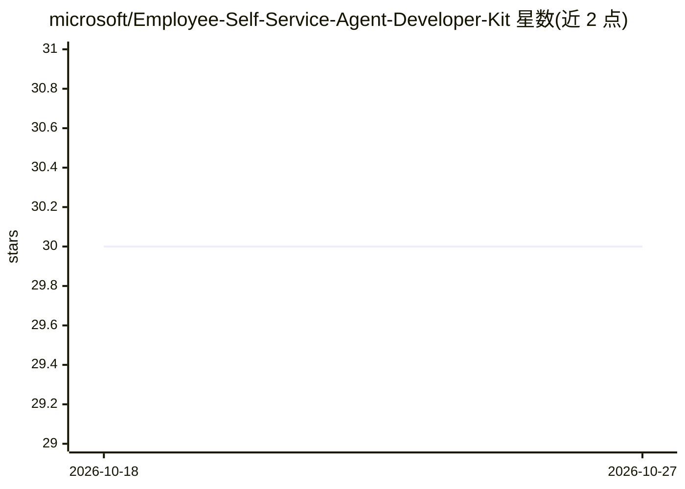

# microsoft/Employee-Self-Service-Agent-Developer-Kit

⭐ 30 · Python · MIT · 推送 2026-10-26 · [GitHub](https://github.com/microsoft/Employee-Self-Service-Agent-Developer-Kit) · 组织维护

**微软 ESS 员工自助服务智能体的定制开发工具包**

微软维护的单仓库，提供基于 Microsoft Copilot Studio 的员工自助服务（ESS）智能体的解决方案、示例与工具。核心组件 ess-maker-skills 允许在 VS Code 中通过 GitHub Copilot Chat 输入 /setup 定制智能体，无需深入平台知识；ess-flightcheck（规划中）可校验部署就绪状态，支持独立 Python CLI 运行。一条命令安装 VS Code、Python 3.12、.NET 运行时等全部依赖。仓库自述为示例与学习工具，非正式产品或受支持服务，需 GitHub Copilot 订阅。

## 筛选速览

| 维度 | 判定 | 备注 |
|---|---|---|
| AI 角色 | `ai-ecosystem` | LLM/agent 周边工具 |
| 许可风险 | `permissive` | MIT |
| 部署形态 | `None` |  |
| 模型依赖 | — | README 未给出锁定关系 |
| 硬件要求 | — | 无带数字的原话,不猜 |
| 安装摩擦 | `low` | 无编译、无系统依赖或容器化 |
| 成熟度 | `idea` | |

## 能力要点

- 一键 bootstrap 脚本安装全套依赖（Windows/macOS）
- 在 VS Code 中通过 Copilot Chat 的 /setup 命令定制 ESS 智能体
- FlightCheck 方案校验许可证、身份、集成与配置（可无 LLM 独立运行）
- 提供图形化快速开始面板与聊天命令两种使用方式

## 适用场景

- 企业在 VS Code 中定制自己的员工自助服务智能体
- 校验 ESS 部署的许可证、身份与配置就绪状态
- 学习基于 Copilot Studio 构建智能体的参考实现

## 场景标签

`Agent 框架` `教程课程` · 领域:Agent 开发

## 证据(README 行号)

> L3: A monorepo of solutions, samples, and tooling for the Microsoft Employee Self-Service (ESS) agent built on Microsoft
> L9: One command installs everything (VS Code, Python 3.12, Git, GitHub CLI, .NET runtime, NuGet, Copilot extensions, pip

## 星数曲线

2026-10-18 30 → 2026-10-27 30（+0）

---
*卡片 v1 · prompt 1.4 · 生成 2026-10-26 · 置信度 high · 依据 README sha `ff4258641f08` · [字段定义](../../DATASET.md)*
