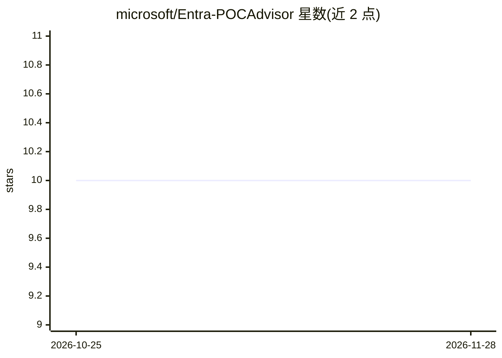

# microsoft/Entra-POCAdvisor

⭐ 10 · MIT · 推送 2026-06-09 · [GitHub](https://github.com/microsoft/Entra-POCAdvisor) · 组织维护

**指导 Entra 管理员做 Entra Suite POC 部署的 Copilot 技能**

一个 GitHub Copilot Skill，面向 Microsoft Entra Suite 管理员，以对话方式引导 POC 部署的规划、配置、验证与文档化。先提问澄清、给出建议，用户确认后才生成 POC 指南、PowerShell 脚本、差距分析报告与 Mermaid 架构图。提供 Guidance Only / Read-Only / Read-Write 三种模式，后两者经 Microsoft MCP Server 实时读取租户配置；即使 Read-Write 模式也不直接写入租户，所有变更由用户审阅脚本后手动执行。内置 22 个预置场景与七条不可覆盖的安全规则（禁止删除操作、禁止无 -WhatIf 脚本等）。

## 筛选速览

| 维度 | 判定 | 备注 |
|---|---|---|
| AI 角色 | `ai-native` | 本体是模型或模型工具 |
| 许可风险 | `permissive` | MIT |
| 部署形态 | `desktop` | 安装包/桌面程序 |
| 模型依赖 | — | README 未给出锁定关系 |
| 硬件要求 | — | 无带数字的原话,不猜 |
| 安装摩擦 | `medium` | 含编译或系统依赖之一 |
| 成熟度 | — | 结构信号不足 |

## 能力要点

- 覆盖 Entra Suite 六个产品的 POC 全生命周期（6 阶段）引导
- 22 个预置场景，支持自然语言描述自定义场景
- 三种操作模式，Read 模式经 Microsoft MCP Server 实时读取租户配置
- 七条强制安全守则：不生成删除调用、脚本必须支持 -WhatIf 干跑

## 适用场景

- 为 Entra Suite 六个产品做 POC 前的需求澄清与产品选型
- 对现有租户配置做差距分析并生成修复脚本
- 生成符合 Microsoft 文档标准的 POC 指南与架构图
- 按预置场景（如 VPN 替换、Web 内容过滤）逐步完成配置与验证

## 场景标签

`聊天机器人` `AI 助手` `代码生成` · 领域:编码与开发

## 证据(README 行号)

> L3: A GitHub Copilot Skill that guides Microsoft Entra administrators through proof-of-concept deployments of the Micros
> L7: Entra-POCAdvisor is designed for **Entra administrators** who need to plan, configure, validate, and document POC de

## 星数曲线

2026-10-25 10 → 2026-11-28 10（+0）

---
*卡片 v1 · prompt 1.4 · 生成 2026-11-19 · 置信度 high · 依据 README sha `ec9e57dfd956` · [字段定义](../../DATASET.md)*
