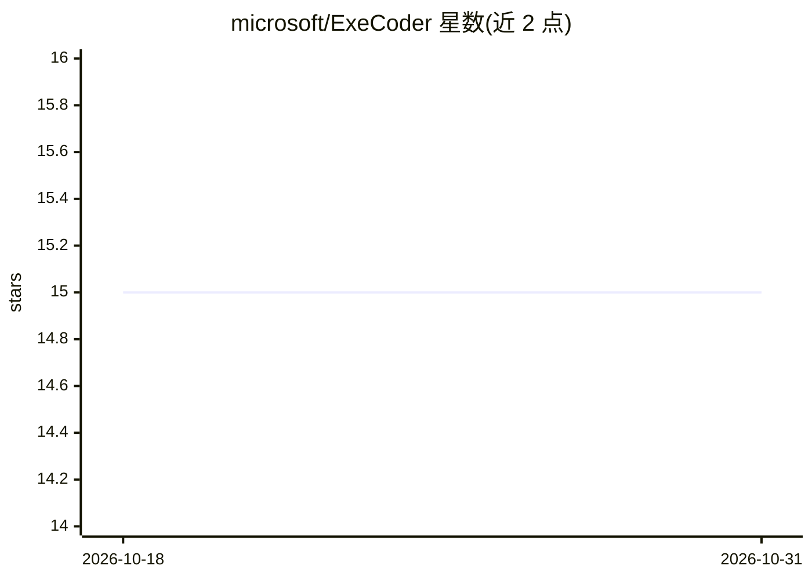

# microsoft/ExeCoder

⭐ 15 · Python · MIT · 推送 2026-05-08 · [GitHub](https://github.com/microsoft/ExeCoder) · 组织维护

**面向代码翻译的可执行性表示微调 LLM 研究项目**

北京大学、微软与 KTH 合作的研究项目：以 deepseek-coder-6.7b-instruct 为基座，通过指令微调注入可执行性表示（功能语义、语法结构、变量依赖）以增强代码翻译能力。流程为：预处理 XLCoST 数据集为 XLCoST-Instruct，运行 train.sh 训练，inference.sh 推理，evaluation.sh 评测；环境依赖 transformers、vllm、tree-sitter 多语言包、deepspeed 等，并需下载 XLCoST 数据、基座模型与 JDK。

## 筛选速览

| 维度 | 判定 | 备注 |
|---|---|---|
| AI 角色 | `ai-native` | 本体是模型或模型工具 |
| 许可风险 | `permissive` | MIT |
| 部署形态 | `None` |  |
| 模型依赖 | locked-api |  |
| 硬件要求 | — | 无带数字的原话,不猜 |
| 安装摩擦 | `low` | 无编译、无系统依赖或容器化 |
| 成熟度 | — | 结构信号不足 |

## 能力要点

- 基于 deepseek-coder-6.7b-instruct 的指令微调流程
- 利用 tree-sitter 生成语法结构与变量依赖表示
- 覆盖 XLCoST 数据集预处理、训练、推理、评测四段脚本

## 适用场景

- 复现代码翻译领域的论文实验
- 在 XLCoST 上训练与评测代码翻译模型
- 研究可执行性表示对 LLM 代码翻译的影响

## 场景标签

`微调` `代码生成` · 领域:编码与开发

## 证据(README 行号)

> L1: # 🔥ExeCoder: Empowering Large Language Models with Executability Representation for Code Translation
> L72: - **Step 2:** Download deepseek-coder-6.7b-instruct and put it under `checkpoint` folder.
> L84: - Instruction Tuning for Learning Executability Representation.

## 星数曲线

2026-10-18 15 → 2026-10-31 15（+0）

---
*卡片 v1 · prompt 1.4 · 生成 2026-10-30 · 置信度 high · 依据 README sha `375508f936b1` · [字段定义](../../DATASET.md)*
