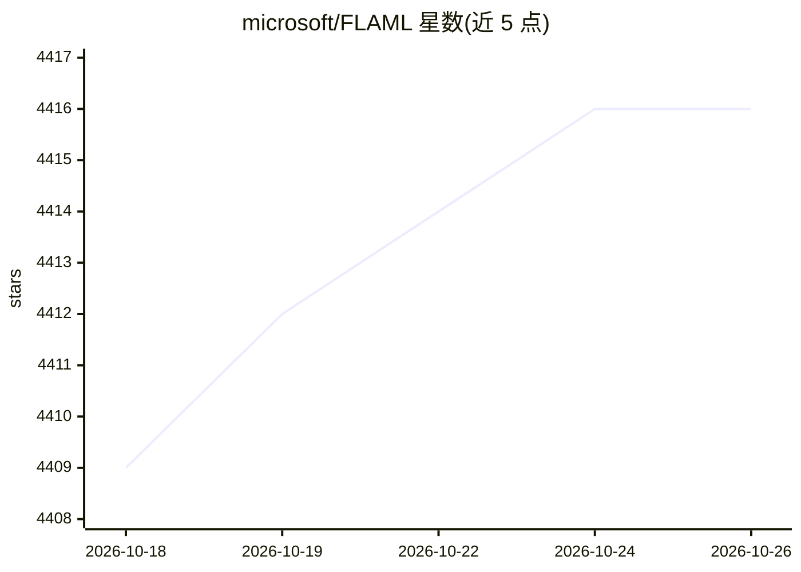

# microsoft/FLAML

⭐ 4,416 · Jupyter Notebook · MIT · 推送 2026-10-25 · [GitHub](https://github.com/microsoft/FLAML) · [官网](https://microsoft.github.io/FLAML/) · 组织维护 · 中文 README

**轻量 AutoML 与超参数优化 Python 库，低算力选出可用模型**

微软开源的机器学习自动化库：在资源约束下自动完成分类/回归任务的模型选择与超参数优化，以 scikit-learn 风格 estimator 三行代码即可启动；也可作为 XGBoost/LightGBM/Random Forest 等的通用调优工具，支持自定义评估函数调优、zero-shot AutoML（按训练数据自动设超参）及大搜索空间与异构评估成本场景。研究来自微软研究院及多所大学，另有 ML.NET 的 .NET 实现。AutoGen 模块已移出。要求 Python >= 3.10 且 < 3.14。

## 筛选速览

| 维度 | 判定 | 备注 |
|---|---|---|
| AI 角色 | `ai-native` | 本体是模型或模型工具 |
| 许可风险 | `permissive` | MIT |
| 部署形态 | `library` | 以包/库形式分发 |
| 模型依赖 | — | README 未给出锁定关系 |
| 硬件要求 | — | 无带数字的原话,不猜 |
| 安装摩擦 | `low` | 无编译、无系统依赖或容器化 |
| 成熟度 | — | 结构信号不足 |

## 能力要点

- AutoML 引擎可作 scikit-learn 风格 estimator，三行代码完成分类/回归
- 对 XGBoost/LightGBM/自定义 learner 做快速超参数调优
- zero-shot AutoML：沿用 lightgbm/xgboost 训练 API，超参按训练数据自动设置
- 支持大搜索空间、异构评估成本与复杂约束/提前停止的调优

## 适用场景

- 我用表格数据快速训练一个分类或回归模型
- 给 XGBoost/LightGBM 或自定义模型做超参数优化
- 在算力预算有限时自动选取可用模型

## 场景标签

`MLOps` · 领域:训练与推理

## 证据(README 行号)

> L17: FLAML is a lightweight Python library for efficient automation of machine
> L22: - For common machine learning tasks like classification and regression, it quickly finds quality models for user-pr
> L55: automl.fit(X_train, y_train, task="classification")

## 星数曲线

2026-10-18 4,409 → 2026-10-26 4,416（+7）

---
*卡片 v1 · prompt 1.4 · 生成 2026-10-20 · 置信度 high · 依据 README sha `36fbe767fd1a` · [字段定义](../../DATASET.md)*
