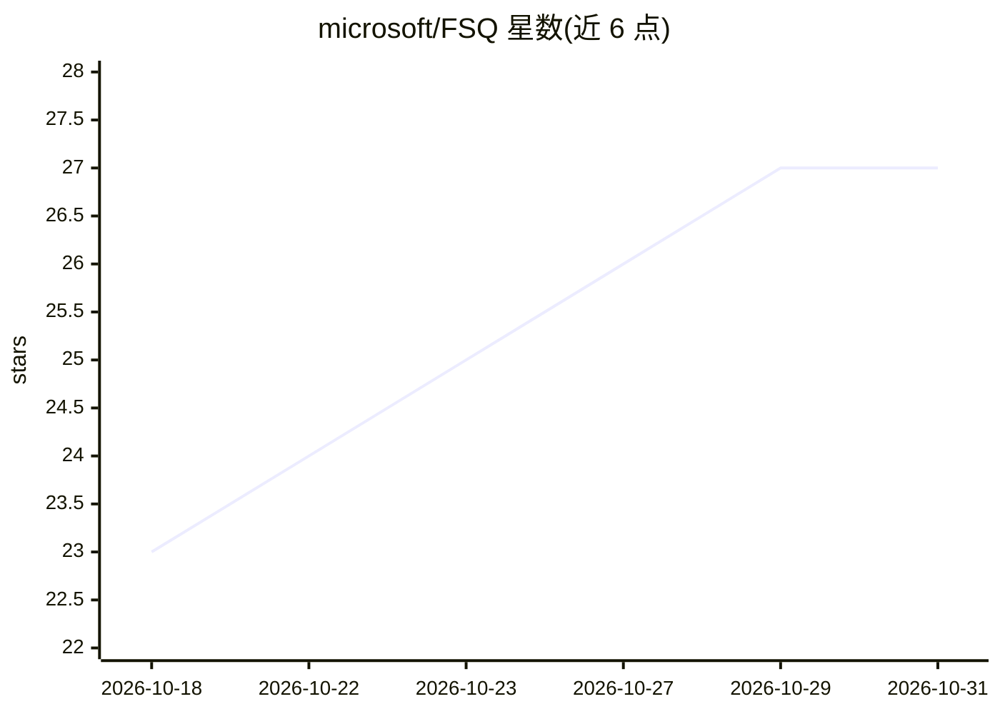

# microsoft/FSQ

⭐ 27 · Python · MIT · 推送 2026-10-23 · [GitHub](https://github.com/microsoft/FSQ) · 组织维护

**微软的 AI UI 自动化执行框架：目标→证据→可回放 Case**

面向 Web/Android/Windows/macOS 的 UI 自动化 harness：将自然语言 Goal 交由 LLM 驱动的真实 UI 执行，落盘截图、UI 快照、事件与报告作为证据，成功运行可生成可审阅的 .fsq.yaml Case，供确定性 Strict Replay 回放；回放与离线报告路径无需配置 LLM Provider，可在 CI 中验证。平台交互由 Playwright、uiautomator2、pywinauto、Appium 承担，浏览器/ADB/Appium 等宿主前置条件需用户自备。以 pip 包 fsq-agent 提供并含本地 Control Plane UI。

## 筛选速览

| 维度 | 判定 | 备注 |
|---|---|---|
| AI 角色 | `ai-ecosystem` | LLM/agent 周边工具 |
| 许可风险 | `permissive` | MIT |
| 部署形态 | `library` | 以包/库形式分发 |
| 模型依赖 | locked-api |  |
| 硬件要求 | — | 无带数字的原话,不猜 |
| 安装摩擦 | `low` | 无编译、无系统依赖或容器化 |
| 成熟度 | `idea` | |

## 能力要点

- 自然语言 Goal → 证据 → 可审阅 YAML Case → 确定性回放的完整链路
- 回放与离线 HTML/JSON/JUnit 导出均无需 LLM Provider，可入 CI
- 四种平台后端（Playwright/uiautomator2/pywinauto/Appium），同一 Case/证据/Run 概念
- 工作区、证据与 Provider 配置默认本地存储

## 适用场景

- 让 AI 探索 UI 操作并沉淀为可回归回放的测试 Case
- CI 中离线验证已提交的 Case 并导出报告
- 编码 agent 通过提供 Goal 让 FSQ 在真实 UI 上验证改动

## 场景标签

`浏览器自动化` `GUI 自动化` · 领域:效率与自动化

## 证据(README 行号)

> L10:  FSQ turns a natural-language Goal into inspectable evidence, a reviewable YAML Case, deterministic Strict Replay, 
> L25: FSQ turns a natural-language UI goal into an observable automation run, saves screenshots, UI snapshots, events, an
> L60: FSQ complements platform automation libraries. Playwright, uiautomator2, pywinauto, and Appium perform platform int

## 星数曲线

2026-10-18 23 → 2026-10-31 27（+4）

---
*卡片 v1 · prompt 1.4 · 生成 2026-10-27 · 置信度 high · 依据 README sha `c0812275af1a` · [字段定义](../../DATASET.md)*
