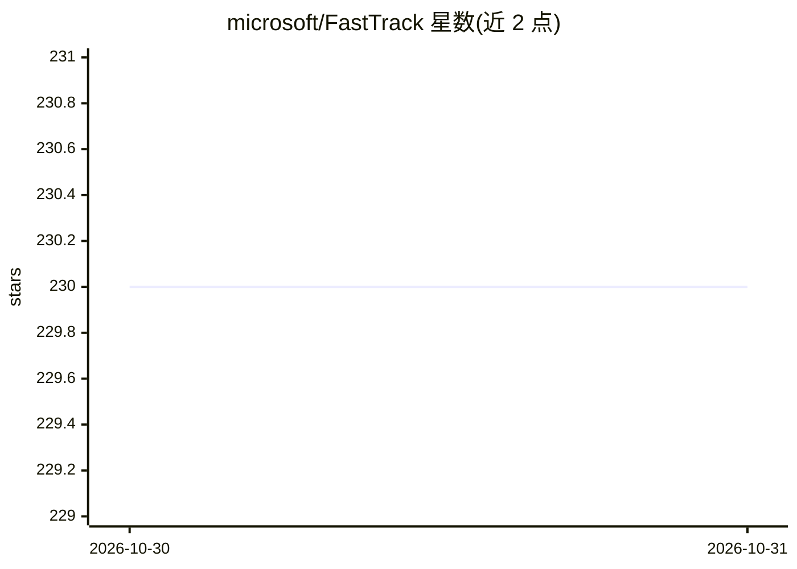

# microsoft/FastTrack

⭐ 230 · HTML · MIT · 推送 2026-10-30 · [GitHub](https://github.com/microsoft/FastTrack) · [官网](https://microsoft.github.io/FastTrack/) · 组织维护

**微软 FastTrack 的 M365 Copilot 部署指南、代理与脚本资源库**

Microsoft FastTrack 团队开源的资源目录仓库，收录规划指南、决策指南、成本计算器、Copilot Studio 与 Agent Builder 代理示例、Power BI 分析模板及 PowerShell 管理脚本，覆盖 Microsoft 365 Copilot 与 Agent 365 的规划、部署、治理与度量。每个资源文件夹含 README 说明用途与运行方式，catalog.json 等由元数据生成目录站点。资源按 as-is 提供，需先在非生产租户测试。

## 筛选速览

| 维度 | 判定 | 备注 |
|---|---|---|
| AI 角色 | `ai-knowledge` | 知识聚合/清单类 |
| 许可风险 | `permissive` | MIT |
| 部署形态 | `None` |  |
| 模型依赖 | — | README 未给出锁定关系 |
| 硬件要求 | — | 无带数字的原话,不猜 |
| 安装摩擦 | `low` | 无编译、无系统依赖或容器化 |
| 成熟度 | — | 结构信号不足 |

## 能力要点

- 四类资源：指南/代理/分析/脚本
- 含 Copilot Studio、Agent Builder、GitHub Copilot 代理与技能示例
- SimpleGraph：PowerShell 的轻量 Microsoft Graph 封装
- catalog.json 与 Atom feed 由资源 README front matter 生成目录站点

## 适用场景

- 规划与部署 Microsoft 365 Copilot 时查找实施指南和计算器
- 获取 Copilot Studio 代理示例与 Power BI 使用分析模板
- 用 PowerShell 脚本管理 Teams、SharePoint、Viva Engage

## 场景标签

`精选清单` · 领域:学习与行业

## 证据(README 行号)

> L5: **Field-tested guides, agents, scripts, and analytics from Microsoft FastTrack to plan, deploy, govern, and measure 
> L19: |Guides & planning|Interactive implementation guides, decision guides, calculators, and planning templates for Copi
> L20: |Agents|Ready-to-use agents for Copilot Studio, Agent Builder, and GitHub Copilot, plus Employee Self-Service exten

## 星数曲线

2026-10-30 230 → 2026-10-31 230（+0）

---
*卡片 v1 · prompt 1.4 · 生成 2026-10-30 · 置信度 high · 依据 README sha `cab375ec91ba` · [字段定义](../../DATASET.md)*
