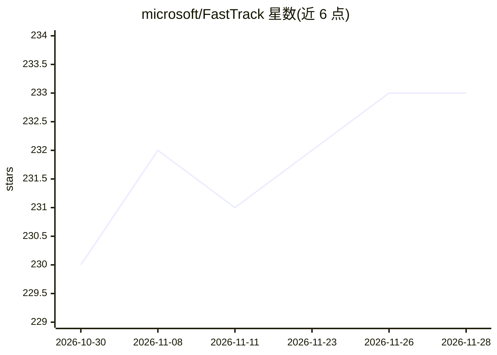

# microsoft/FastTrack

⭐ 233 · HTML · MIT · 推送 2026-11-27 · [GitHub](https://github.com/microsoft/FastTrack) · [官网](https://microsoft.github.io/FastTrack/) · 组织维护

**企业用 FastTrack 资源部署治理 M365 Copilot 与代理**

Microsoft FastTrack 开源仓库，收录经过现场实践的资源：面向 Copilot 与 Agent 部署的交互式实施指南、成本计算器与规划模板；Copilot Studio/Agent Builder/GitHub Copilot 的现成代理；Power BI 分析模板与使用量报表；以及 Microsoft 365 管理 PowerShell 脚本与 SimpleGraph 工具。资源以目录站点形式检索，各文件夹含独立 README 说明需求与运行方式。官方声明资源按原样提供、非官方支持软件、无 SLA，建议先在非生产租户测试；部分资源标注 Archived 或 Preview。

## 筛选速览

| 维度 | 判定 | 备注 |
|---|---|---|
| AI 角色 | `ai-knowledge` | 知识聚合/清单类 |
| 许可风险 | `permissive` | MIT |
| 部署形态 | `None` |  |
| 模型依赖 | — | README 未给出锁定关系 |
| 硬件要求 | — | 无带数字的原话,不猜 |
| 安装摩擦 | `low` | 无编译、无系统依赖或容器化 |
| 成熟度 | — | 结构信号不足 |

## 能力要点

- 交互式实施指南、成本计算器与规划模板
- Copilot Studio / Agent Builder / GitHub Copilot 的现成代理
- Power BI 模板与 Copilot 使用量报表
- Microsoft 365 管理 PowerShell 脚本与 SimpleGraph 工具

## 适用场景

- 规划企业 Copilot 部署路径并估算成本
- 部署现成的 Copilot Studio 代理或员工自助扩展
- 用 Power BI 模板分析租户内 Copilot 使用情况
- 用 PowerShell 脚本管理 Teams/SharePoint 等服务

## 场景标签

`教程课程` · 领域:学习与行业

## 证据(README 行号)

> L5: **Field-tested guides, agents, scripts, and analytics from Microsoft FastTrack to plan, deploy, govern, and measure 
> L19: |Guides & planning|Interactive implementation guides, decision guides, calculators, and planning templates for Copi
> L42: Every resource folder has a README that explains what it does, what it needs, and how to run it. Resources are prov

## 星数曲线

2026-10-30 230 → 2026-11-28 233（+3）

---
*卡片 v1 · prompt 1.4 · 生成 2026-11-25 · 置信度 high · 依据 README sha `e1954fe11a71` · [字段定义](../../DATASET.md)*
