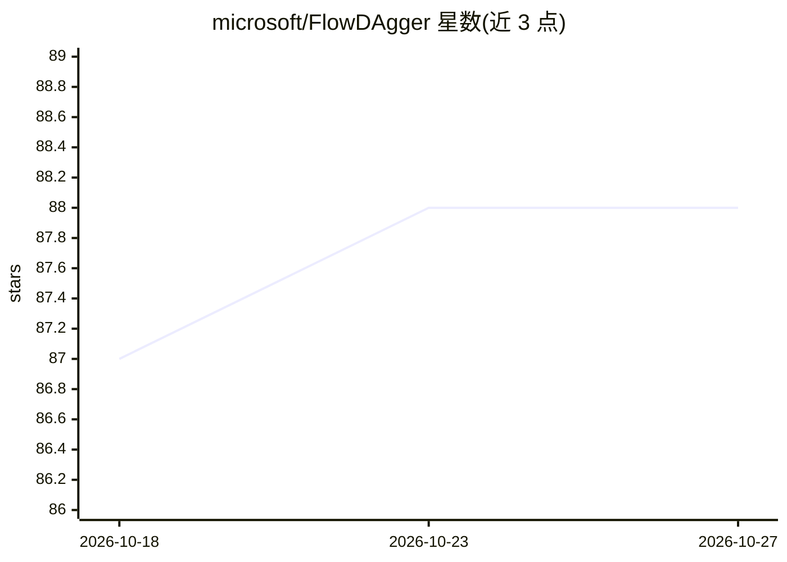

# microsoft/FlowDAgger

⭐ 88 · Python · MIT · 推送 2026-10-23 · [GitHub](https://github.com/microsoft/FlowDAgger) · [官网](https://microsoft.github.io/FlowDAgger) · 组织维护

**机器人生成式策略的潜空间人机协同适应方法参考实现**

CoRL 2026 论文 FlowDAgger 的官方实现：针对流匹配与扩散类机器人策略，不微调基础策略，而是训练一个小的转向网络（steering network），输出以观测为条件的初始潜变量供采样器使用。专家纠正动作通过反转策略的采样 ODE 映射回初始潜空间，转向网络用行为克隆损失（MSE）拟合这些反转目标。仓库提供两个后端的最小参考实现：JAX/pi0.5（MetaWorld assembly）与 PyTorch/GR00T N1.7（LIBERO-90 task 57），各自使用独立 Python 环境，面向机器人学习研究者。MIT 许可。

## 筛选速览

| 维度 | 判定 | 备注 |
|---|---|---|
| AI 角色 | `ai-ecosystem` | LLM/agent 周边工具 |
| 许可风险 | `permissive` | MIT |
| 部署形态 | `None` |  |
| 模型依赖 | — | README 未给出锁定关系 |
| 硬件要求 | — | 无带数字的原话,不猜 |
| 安装摩擦 | `low` | 无编译、无系统依赖或容器化 |
| 成熟度 | — | 结构信号不足 |

## 能力要点

- 潜空间 DAgger：不修改基础策略权重即可注入专家纠正
- 专家动作经采样 ODE 反演映射为初始潜变量目标
- 提供 pi0.5（JAX/openpi 子模块）与 GR00T N1.7（PyTorch）两个后端示例

## 适用场景

- 在仿真任务（MetaWorld/LIBERO）上复现论文的人机协同适应流程
- 为流匹配/扩散机器人策略添加专家纠正式适应能力
- 基于参考实现扩展到自己的基础策略后端

## 场景标签

`科研工具` · 领域:学习与行业

## 证据(README 行号)

> L7: FlowDAgger is latent-space DAgger for flow-matching and diffusion based robot policies. Instead of
> L14: This repo contains minimal reference implementations for two base-policy

## 星数曲线

2026-10-18 87 → 2026-10-27 88（+1）

---
*卡片 v1 · prompt 1.4 · 生成 2026-10-23 · 置信度 high · 依据 README sha `98f8911de5c1` · [字段定义](../../DATASET.md)*
