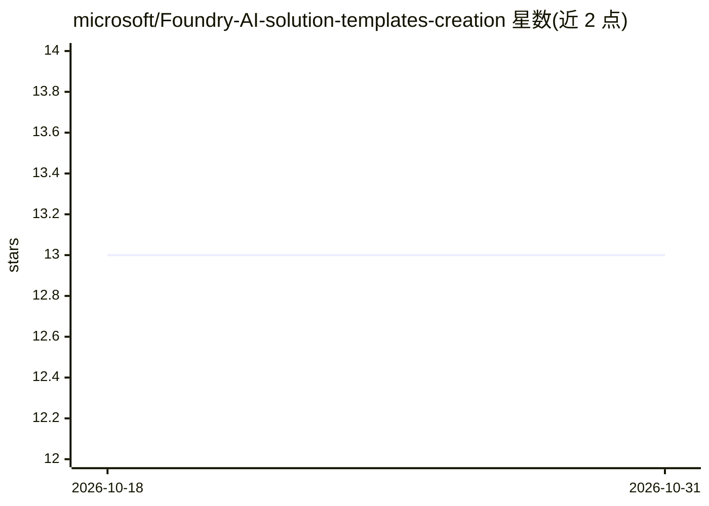

# microsoft/Foundry-AI-solution-templates-creation

⭐ 13 · MIT · 推送 2026-04-23 · [GitHub](https://github.com/microsoft/Foundry-AI-solution-templates-creation) · 组织维护

**面向 AI 编码 agent 的 Azure 项目脚手架生成技能**

以 SKILL.md + references 形式分发的 agent 技能：安装到 Claude Code、GitHub Copilot、Codex、Cursor、Windsurf 等工具后，通过自适应提问（11 个通用问题 + 6-11 个类型问题）生成 8 类 Azure 项目的完整工程，含源码、Bicep 基础设施、Docker、CI/CD 与负责任 AI 文档，可用 azd up 一键部署。采用渐进式披露按需加载参考文件。README 声明生成的脚手架默认无认证、内存存储，需加固后才适合生产。

## 筛选速览

| 维度 | 判定 | 备注 |
|---|---|---|
| AI 角色 | `ai-ecosystem` | LLM/agent 周边工具 |
| 许可风险 | `permissive` | MIT |
| 部署形态 | `self-host` | docker 或自建部署 |
| 模型依赖 | locked-api |  |
| 硬件要求 | — | 无带数字的原话,不猜 |
| 安装摩擦 | `low` | 无编译、无系统依赖或容器化 |
| 成熟度 | — | 结构信号不足 |

## 能力要点

- 支持 8 类项目：RAG 聊天机器人、多 agent 系统、API、数据管道、Functions、全栈 Web、ML 训练推理、事件驱动微服务
- 生成的项目含 Bicep 基础设施、Dockerfile、GitHub Actions CI/CD、TRANSPARENCY_FAQ 与架构图
- 渐进式披露：agent 只加载所选类型的参考文件
- npx skills add 一条命令安装，兼容 Claude Code/Copilot/Codex/Cursor/Windsurf

## 适用场景

- 让 Claude Code 或 Copilot 替我生成可部署的 Azure RAG 聊天机器人工程
- 快速搭建带基础设施与 CI/CD 的多 agent 系统起点
- 生成含 Docker compose 的本地开发环境以便无 Azure 也能运行

## 场景标签

`代码生成` · 领域:编码与开发

## 证据(README 行号)

> L3: A universal AI agent skill that scaffolds complete, production-ready Azure projects through adaptive questioning. Wo
> L21: Every scaffolded project is fully deployable with `azd up`. No manual assembly required.

## 星数曲线

2026-10-18 13 → 2026-10-31 13（+0）

---
*卡片 v1 · prompt 1.4 · 生成 2026-10-31 · 置信度 mid · 依据 README sha `314e5fd5b551` · [字段定义](../../DATASET.md)*
