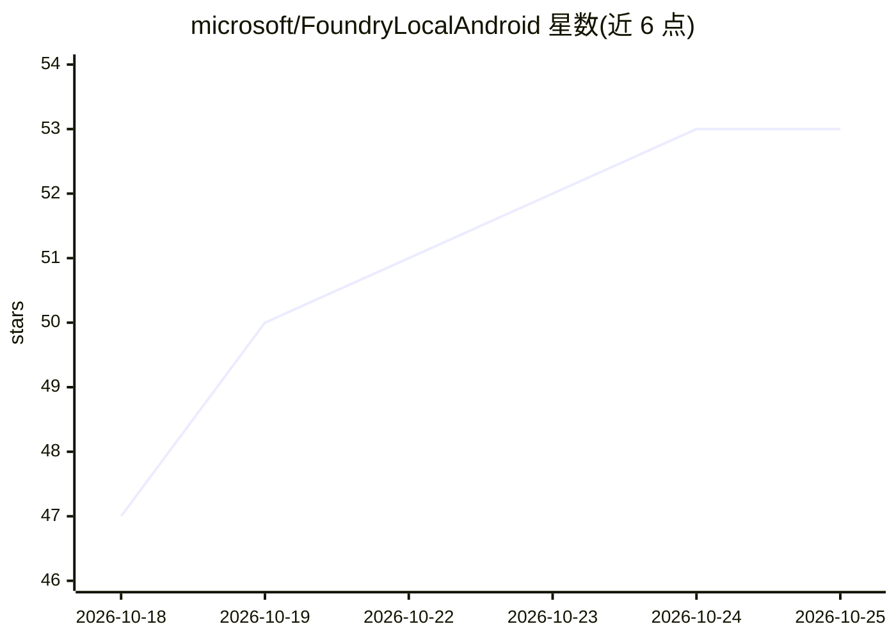

# microsoft/FoundryLocalAndroid

⭐ 53 · NOASSERTION · 推送 2026-10-17 · [GitHub](https://github.com/microsoft/FoundryLocalAndroid) · 组织维护

**面向 Android 开发者的端侧生成式 AI 推理 SDK**

微软 Foundry Local 的 Android 端实现：提供 Kotlin API 在 Android 设备上运行生成式 AI 模型，无需云端，支持流式聊天补全、文件与实时音频转录、多轮对话、模型下载与缓存管理及温度/top-k/top-p 等请求控制。提供两种部署模式：IPC 模式（薄 SDK，推理在独立 Foundry Local 服务应用中进行，APK 体积小）与 Embedded 模式（内置完整推理引擎与原生库，不依赖服务应用）。SDK 以 AAR 形式从 GitHub Releases 分发，需手动放入 libs 目录并添加依赖；仓库含 5 个示例应用。项目处于 Preview 阶段，API 可能随版本变化；仓库 MIT 许可不覆盖 SDK AAR，其许可随产物附带。

## 筛选速览

| 维度 | 判定 | 备注 |
|---|---|---|
| AI 角色 | `ai-ecosystem` | LLM/agent 周边工具 |
| 许可风险 | `none` | NOASSERTION |
| 部署形态 | `None` |  |
| 模型依赖 | — | README 未给出锁定关系 |
| 硬件要求 | — | 无带数字的原话,不猜 |
| 安装摩擦 | `low` | 无编译、无系统依赖或容器化 |
| 成熟度 | `idea` | |

## 能力要点

- Android 设备端运行生成式模型，无云端、按请求零费用
- IPC 与 Embedded 两种部署模式，暴露同一 Kotlin API
- 流式聊天补全与文件/实时音频转录
- 模型下载、加载、卸载与缓存管理，支持协程取消

## 适用场景

- 在我的 Android 应用中集成离线聊天与语音转录功能
- 受 APK 体积限制时用 IPC 模式借助服务应用做推理
- 需要完全自包含推理能力的应用选用 Embedded 模式

## 场景标签

`推理引擎` `语音识别` · 领域:感知与多模态

## 证据(README 行号)

> L4:  Run generative AI models directly on Android devices — no cloud, no cost per request, fully private.
> L30: Foundry Local runs AI models on the Android device. Choose one deployment mode:

## 星数曲线

2026-10-18 47 → 2026-10-25 53（+6）

---
*卡片 v1 · prompt 1.4 · 生成 2026-10-24 · 置信度 high · 依据 README sha `00a5525f96eb` · [字段定义](../../DATASET.md)*
