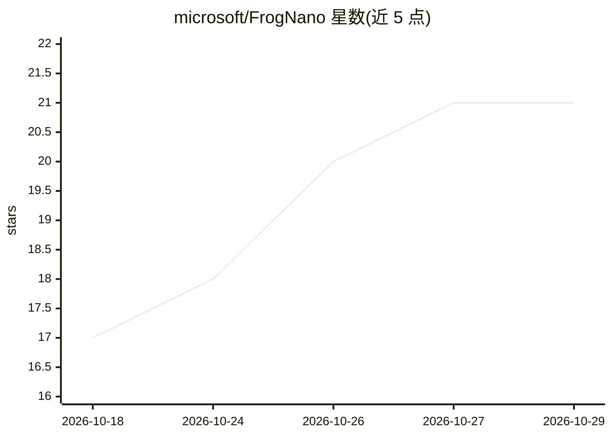

# microsoft/FrogNano

⭐ 21 · Python · MIT · 推送 2026-10-27 · [GitHub](https://github.com/microsoft/FrogNano) · 组织维护

**4B 编码智能体的运行框架与评测工具，跑在 Kubernetes 沙箱**

FrogNano 是基于 Qwen3.5-4B 的紧凑编码智能体，本仓库提供其 Leaf 运行框架（harness）与评测工具：在隔离的 Kubernetes 沙箱中运行编码智能体，支持 OpenAI 兼容模型端点，提供 Read/Write/Edit/Glob/Bash 五种工具，可运行 SWE-bench Verified/Pro、Terminal-Bench 2.0、PatchEval 等基准，输出 results.jsonl 与 summary.json，支持断点续跑与可选 W&B 追踪。训练侧仅用约 1,500 个合成软件工程任务环境做强化学习。使用需 Python 3.12+、Kubernetes 集群与容器镜像拉取权限。

## 筛选速览

| 维度 | 判定 | 备注 |
|---|---|---|
| AI 角色 | `ai-native` | 本体是模型或模型工具 |
| 许可风险 | `permissive` | MIT |
| 部署形态 | `library` | 以包/库形式分发 |
| 模型依赖 | — | README 未给出锁定关系 |
| 硬件要求 | — | 无带数字的原话,不猜 |
| 安装摩擦 | `low` | 无编译、无系统依赖或容器化 |
| 成熟度 | — | 结构信号不足 |

## 能力要点

- Leaf harness 在 Kubernetes 隔离沙箱中运行编码智能体，支持五种工具
- 内置 SWE-bench Verified/Pro、Terminal-Bench 2.0、PatchEval 四套评测预设
- 支持任意 OpenAI 兼容端点（含 reasoning/tool-call parser 配置）
- 评测支持断点续跑、镜像摘要锁定与可选 W&B 指标追踪

## 适用场景

- 在 Kubernetes 环境中对编码智能体做可复现的基准评测
- 复现 FrogNano/Qwen3.5-4B 编码智能体的评测结果
- 自定义任务子集做冒烟测试或按需扩展评测配置

## 场景标签

`编码 Agent` `模型评测` · 领域:编码与开发

## 证据(README 行号)

> L3: FrogNano is a compact 4B coding agent built on Qwen3.5-4B for repository-level
> L12: This repository provides the Leaf harness and evaluation tooling for running

## 星数曲线

2026-10-18 17 → 2026-10-29 21（+4）

---
*卡片 v1 · prompt 1.4 · 生成 2026-10-28 · 置信度 high · 依据 README sha `6985951f9e53` · [字段定义](../../DATASET.md)*
