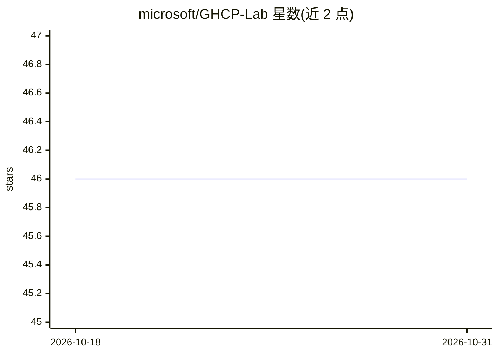

# microsoft/GHCP-Lab

⭐ 46 · C++ · MIT · 推送 2026-03-30 · [GitHub](https://github.com/microsoft/GHCP-Lab) · 组织维护

**面向开发者的 GitHub Copilot 实操训练营课程仓库**

Microsoft 维护的自助式学习实验室，通过 CodeTour 扩展引导学习者完成练习与测验，讲解 GitHub Copilot 的 Agent/Ask/Edit 模式、内联聊天、补全、Coding agent、CLI 等功能，以及 @/# 别名与斜杠命令的使用时机。提供 dotNet、TypeScript、C++ 三个工作区，学习路径包含用 SDD（规格驱动开发）原则构建一个小应用。运行需要 VS Code（或 Insiders）与 Copilot 许可证。仓库声明内容随产品更新但不保证覆盖全部最新功能。

## 筛选速览

| 维度 | 判定 | 备注 |
|---|---|---|
| AI 角色 | `ai-knowledge` | 知识聚合/清单类 |
| 许可风险 | `permissive` | MIT |
| 部署形态 | `None` |  |
| 模型依赖 | — | README 未给出锁定关系 |
| 硬件要求 | — | 无带数字的原话,不猜 |
| 安装摩擦 | `medium` | 含编译或系统依赖之一 |
| 成熟度 | — | 结构信号不足 |

## 能力要点

- 通过 CodeTour 扩展按步骤自学，可回看与自定节奏
- 覆盖 Copilot Agent/Ask/Edit、内联聊天、补全、CLI 等功能与选用时机
- 提供 dotNet / TypeScript / C++ 三个语言工作区
- 实践环节含用 SDD 原则构建小应用

## 适用场景

- 系统学习 GitHub Copilot 各模式与命令的适用场景
- 团队或个人上手 AI 辅助编程的培训材料
- 了解如何利用上下文让补全一次到位

## 场景标签

`教程课程` · 领域:学习与行业

## 证据(README 行号)

> L7: ## What will we learn in this lab?
> L18: Using the *_CodeTour_ extension, you will receive assignments, learn beginner and advanced tips and tricks, answer 

## 星数曲线

2026-10-18 46 → 2026-10-31 46（+0）

---
*卡片 v1 · prompt 1.4 · 生成 2026-10-25 · 置信度 high · 依据 README sha `059f000943b7` · [字段定义](../../DATASET.md)*
