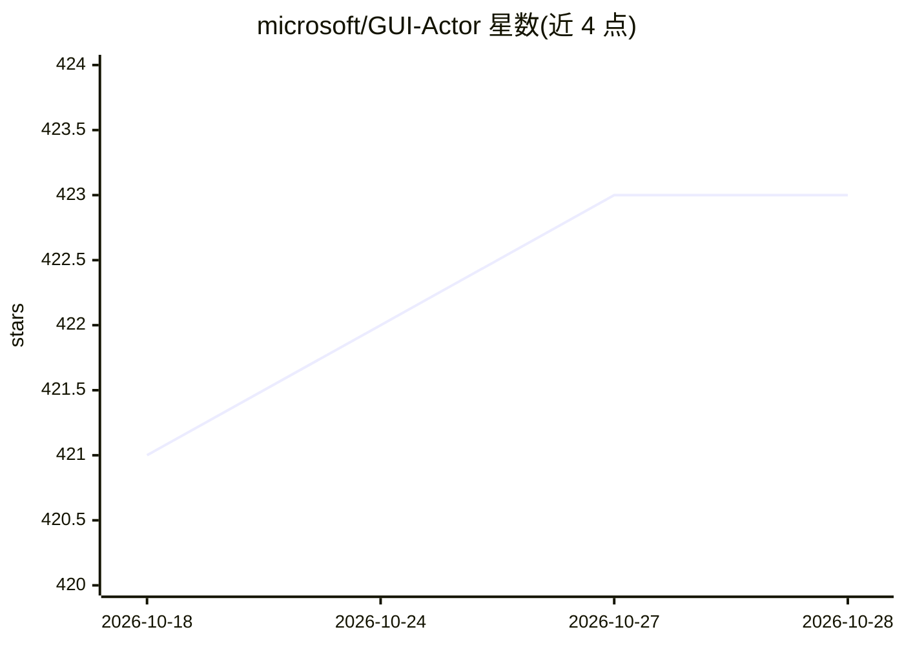

# microsoft/GUI-Actor

⭐ 424 · Python · MIT · 推送 2026-04-13 · [GitHub](https://github.com/microsoft/GUI-Actor) · [官网](https://microsoft.github.io/GUI-Actor/) · 组织维护

**GUI Agent 的免坐标视觉定位模型：为界面元素定位动作区域**

微软研究院等机构提出的 VLM+动作头方案（NeurIPS'25）：针对坐标生成式 GUI 定位在空间-语义对齐、监督信号与粒度匹配上的问题，用注意力动作头在单次前向中生成多个候选区域，无需输出坐标文本，并以 grounding verifier 从中选取区域。基于 Qwen2-VL/Qwen2.5-VL 骨干，提供 2B/3B/7B 检查点、处理后训练数据与演示，支持 conda 环境下源码安装、训练与在 ScreenSpot 系列基准上评测。

## 筛选速览

| 维度 | 判定 | 备注 |
|---|---|---|
| AI 角色 | `ai-native` | 本体是模型或模型工具 |
| 许可风险 | `permissive` | MIT |
| 部署形态 | `library` | 以包/库形式分发 |
| 模型依赖 | — | README 未给出锁定关系 |
| 硬件要求 | — | 无带数字的原话,不猜 |
| 安装摩擦 | `medium` | 含编译或系统依赖之一 |
| 成熟度 | — | 结构信号不足 |

## 能力要点

- 注意力动作头实现免坐标 GUI 定位，单次前向生成多候选区域
- grounding verifier 从候选区域中选取动作区域，可集成到其他定位方法
- 基于 Qwen2-VL / Qwen2.5-VL，提供 2B/3B/7B 检查点与处理后训练数据
- 在 ScreenSpot-Pro / ScreenSpot / ScreenSpot-v2 基准上评测

## 适用场景

- 训练或评测 GUI agent 的界面元素定位模块
- 在 ScreenSpot 系列基准上复现定位结果
- 研究免坐标的动作注意力定位机制

## 场景标签

`GUI 自动化` · 领域:效率与自动化

## 证据(README 行号)

> L36: 🚀 **We propose _GUI-Actor_, a VLM enhanced by an action head, to mitigate the above limitations.** The attention-ba
> L38: ➕ **We design a _grounding verifier_ to evaluate and select the most plausible action region** among the candidates

## 星数曲线

2026-10-18 421 → 2026-10-28 423（+2）

---
*卡片 v1 · prompt 1.4 · 生成 2026-10-21 · 置信度 high · 依据 README sha `c75c5dbac478` · [字段定义](../../DATASET.md)*
