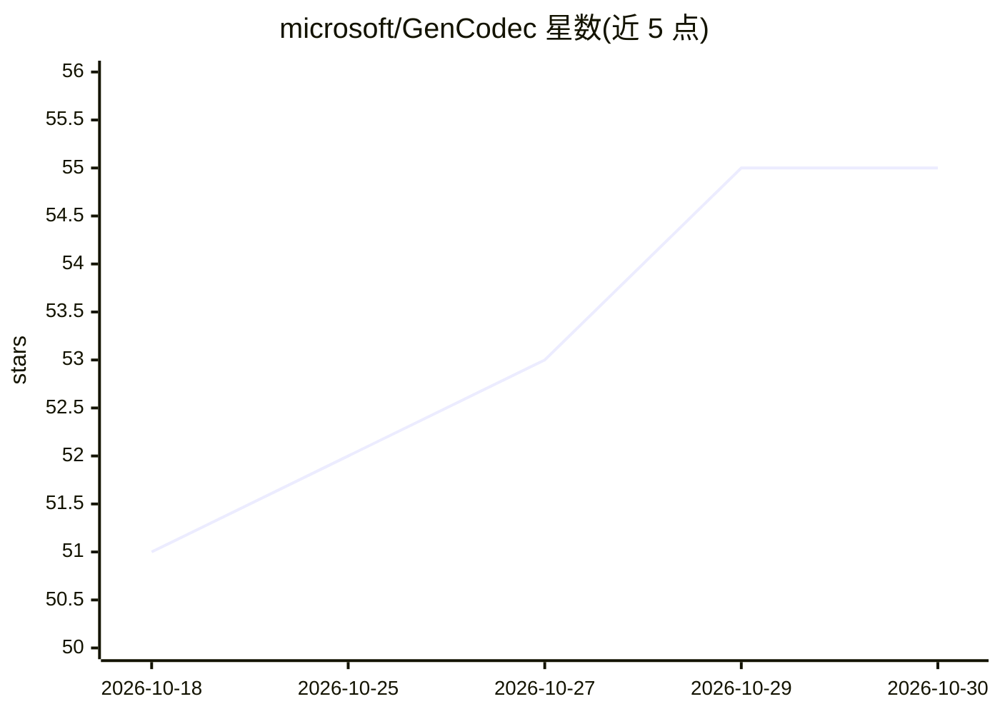

# microsoft/GenCodec

⭐ 55 · C++ · MIT · 推送 2026-09-18 · [GitHub](https://github.com/microsoft/GenCodec) · 组织维护

**微软亚洲研究院生成式图像视频压缩研究项目集合**

Microsoft Research Asia 的研究计划仓库，托管生成式与实用神经压缩方法的模型、代码与评测工具。包含三个项目：CoD（压缩原生扩散基础模型，CVPR 2026，支持像素空间与潜空间扩散统一架构）；CoD_Lite（实时编解码，1080p 单张 A100 上编码 60 FPS）；PULSE（面向单线程 CPU 的超低复杂度解码，5.2 kMAC/pixel，含 CPU/H100 GPU/移动 NPU 部署工具）。模型托管在 Hugging Face，论文发表于 arXiv。

## 筛选速览

| 维度 | 判定 | 备注 |
|---|---|---|
| AI 角色 | `ai-native` | 本体是模型或模型工具 |
| 许可风险 | `permissive` | MIT |
| 部署形态 | `None` |  |
| 模型依赖 | — | README 未给出锁定关系 |
| 硬件要求 | — | 无带数字的原话,不猜 |
| 安装摩擦 | `low` | 无编译、无系统依赖或容器化 |
| 成熟度 | — | 结构信号不足 |

## 能力要点

- CoD：压缩原生扩散基础模型，支持零样本可变码率编码
- CoD_Lite：实时编解码（1080p@60FPS 编码，单 A100）
- PULSE：单线程 CPU 解码，5.2 kMAC/pixel，含移动 NPU 部署工具
- MIT 许可，模型托管于 Hugging Face

## 适用场景

- 超低码率下的图像与视频压缩研究
- 在 CPU/移动 NPU 等设备上部署神经编解码
- 以压缩模型为基础扩展其他视觉任务

## 场景标签

`图像视频处理` · 领域:感知与多模态

## 证据(README 行号)

> L7: **GenCodec** is a research initiative from Microsoft Research Asia pushing the boundaries of generative models for i
> L14: This repository hosts models, code, and evaluation tools for our generative and practical neural compression method
> L19:  - Compression-native diffusion model trained from scratch for image compression

## 星数曲线

2026-10-18 51 → 2026-10-30 55（+4）

---
*卡片 v1 · prompt 1.4 · 生成 2026-10-24 · 置信度 high · 依据 README sha `c8688f7a66a0` · [字段定义](../../DATASET.md)*
