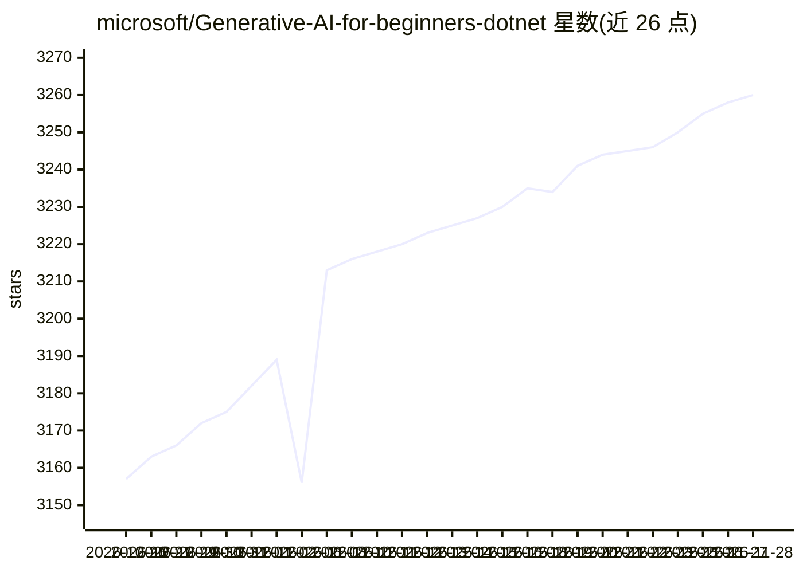

# microsoft/Generative-AI-for-beginners-dotnet

⭐ 3,260 · C# · MIT · 推送 2026-11-27 · [GitHub](https://github.com/microsoft/Generative-AI-for-beginners-dotnet) · [官网](https://aka.ms/genainet) · 组织维护

**面向 .NET 开发者的生成式 AI 应用实战课程（5 课）**

微软维护的 .NET 生成式 AI 入门课程，包含五节课：生成式 AI 介绍、生成式 AI 技术与 Microsoft.Extensions.AI 调用、语义搜索/RAG 等模式、基于 Microsoft Agent Framework 的 Agent 开发、负责任 AI。每课提供可运行的完整代码示例、视频与分步指南，覆盖 28+ 个 Agent Framework 示例及本地决策模型、Milvus 向量检索等新增样本。运行需 .NET 11 SDK，AI 侧可在 Ollama/Foundry Local（本地）或 Azure OpenAI/Microsoft Foundry（云）之间选择，本地路径无需 Azure 账号。

## 筛选速览

| 维度 | 判定 | 备注 |
|---|---|---|
| AI 角色 | `ai-knowledge` | 知识聚合/清单类 |
| 许可风险 | `permissive` | MIT |
| 部署形态 | `None` |  |
| 模型依赖 | local-ok | 支持本地模型 |
| 硬件要求 | — | 无带数字的原话,不猜 |
| 安装摩擦 | `medium` | 含编译或系统依赖之一 |
| 成熟度 | — | 结构信号不足 |

## 能力要点

- 5 节课覆盖文本生成、RAG、语义搜索、Agent 与负责任 AI
- 提供 Ollama / Foundry Local 本地推理路径，无需 Azure 账号或 API key
- 28+ 个 Microsoft Agent Framework 示例，含多 Agent 工作流与 MCP 集成
- GitHub Codespaces 集成与 9 种语言翻译

## 适用场景

- 作为 .NET 开发者系统学习如何在项目中接入生成式 AI
- 按本地学习路径用 Ollama/Foundry Local 跑通聊天、RAG 与 Agent 示例
- 学习用 Microsoft Agent Framework 构建多 Agent 应用
- 了解内容安全与偏见缓解等负责任 AI 实践

## 场景标签

`教程课程` · 领域:学习与行业

## 证据(README 行号)

> L1: # Generative AI for Beginners .NET - A Course
> L108: ## 🗃️ Lessons
> L21: Welcome to **Generative AI for Beginners .NET**, the hands-on course for .NET developers diving into the world of G

## 星数曲线

2026-10-26 3,157 → 2026-11-28 3,260（+103）

---
*卡片 v1 · prompt 1.4 · 生成 2026-11-27 · 置信度 high · 依据 README sha `3764413f6411` · [字段定义](../../DATASET.md)*
