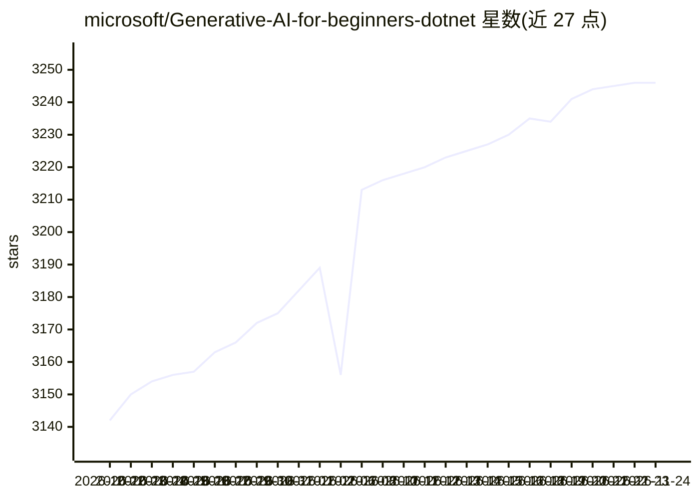

# microsoft/Generative-AI-for-beginners-dotnet

⭐ 3,250 · C# · MIT · 推送 2026-11-23 · [GitHub](https://github.com/microsoft/Generative-AI-for-beginners-dotnet) · [官网](https://aka.ms/genainet) · 组织维护 · 中文 README

**.NET 开发者的生成式 AI 实战课程（5 课）**

微软维护的 .NET 生成式 AI 教程仓库，共 5 课：生成式 AI 入门、技术基础（聊天、嵌入、Microsoft.Extensions.AI）、模式与应用（语义搜索、RAG）、Microsoft Agent Framework 构建 Agent、负责任 AI。每课含视频、可运行代码样例与分步指引。提供 Ollama 本地路线与 Azure 路线（setup.ps1 自动部署资源），样例统一指向 .NET 11 并锁定 NuGet 版本，另提供 8 种语言的翻译 README。

## 筛选速览

| 维度 | 判定 | 备注 |
|---|---|---|
| AI 角色 | `ai-knowledge` | 知识聚合/清单类 |
| 许可风险 | `permissive` | MIT |
| 部署形态 | `None` |  |
| 模型依赖 | local-ok | 支持本地模型 |
| 硬件要求 | — | 无带数字的原话,不猜 |
| 安装摩擦 | `medium` | 含编译或系统依赖之一 |
| 成熟度 | — | 结构信号不足 |

## 能力要点

- 5 课覆盖从文本生成到 RAG 与多 Agent 编排
- Ollama 本地路线无需 Azure 账号与 API key
- 28 个 Microsoft Agent Framework 样例已升级至 stable v1.0
- 提供 GitHub Codespaces 集成与多语言翻译

## 适用场景

- 学习在 .NET 项目中实现生成式 AI 功能
- 通过样例上手 Semantic Kernel 与 Agent Framework
- 在本地用 Ollama 离线跑通 RAG 与 Agent 样例

## 场景标签

`教程课程` · 领域:学习与行业

## 证据(README 行号)

> L1: # Generative AI for Beginners .NET - A Course
> L21: Welcome to **Generative AI for Beginners .NET**, the hands-on course for .NET developers diving into the world of G
> L96: ## 🗃️ Lessons

## 星数曲线

2026-10-22 3,142 → 2026-11-24 3,246（+104）

---
*卡片 v1 · prompt 1.4 · 生成 2026-11-23 · 置信度 high · 依据 README sha `25ee9ca56f6d` · [字段定义](../../DATASET.md)*
