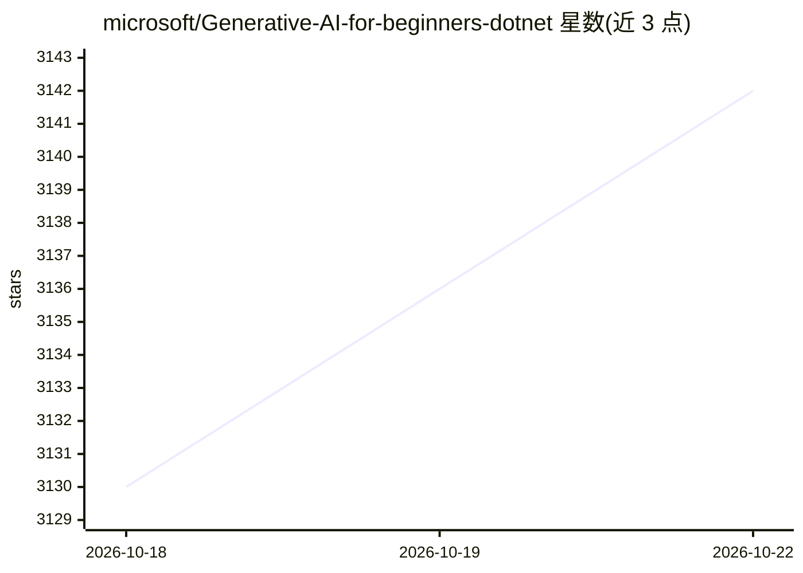

# microsoft/Generative-AI-for-beginners-dotnet

⭐ 3,150 · C# · MIT · 推送 2026-10-22 · [GitHub](https://github.com/microsoft/Generative-AI-for-beginners-dotnet) · [官网](https://aka.ms/genainet) · 组织维护

**微软面向 .NET 开发者的生成式 AI 入门课程（5 课）**

微软维护的动手实践课程，教 .NET 开发者在应用中接入生成式 AI：5 节课覆盖生成式 AI 概念、Microsoft.Extensions.AI 抽象、RAG 与语义搜索、Microsoft Agent Framework 构建 agent 与 MCP 集成、负责任 AI。每课配 5-10 分钟视频与可运行的 .NET 代码示例，支持 GitHub Codespaces 一键环境或 Azure 自动部署脚本（setup.ps1，部署 gpt-5-mini 等资源），也可用 Ollama 本地运行模型。提供 8 种语言的 README 翻译。

## 筛选速览

| 维度 | 判定 | 备注 |
|---|---|---|
| AI 角色 | `ai-knowledge` | 知识聚合/清单类 |
| 许可风险 | `permissive` | MIT |
| 部署形态 | `None` |  |
| 模型依赖 | local-ok | 支持本地模型 |
| 硬件要求 | — | 无带数字的原话,不猜 |
| 安装摩擦 | `medium` | 含编译或系统依赖之一 |
| 成熟度 | — | 结构信号不足 |

## 能力要点

- 5 节课覆盖 chat/RAG/agent/MCP/负责任 AI，含可运行 .NET 示例
- GitHub Codespaces 一键环境或 setup.ps1 自动部署 Azure 资源
- 支持 Azure OpenAI / Microsoft Foundry 云端与 Ollama 本地模型两种路径
- 28 个 Microsoft Agent Framework v1.0 示例与 Foundry Local 本地运行示例

## 适用场景

- 作为 .NET 开发者系统学习生成式 AI 应用开发
- 在 Codespaces 中免配置运行课程示例
- 参考 Agent Framework 多 agent 与 MCP 集成示例代码

## 场景标签

`教程课程` · 领域:学习与行业

## 证据(README 行号)

> L21: Welcome to **Generative AI for Beginners .NET**, the hands-on course for .NET developers diving into the world of G
> L92: |#|**Lesson Link**|**Description**|
> L94: |01|**Introduction to Generative AI**|What generative AI is and how it differs from traditional programming Why .NE

## 星数曲线

2026-10-18 3,130 → 2026-10-22 3,142（+12）

---
*卡片 v1 · prompt 1.4 · 生成 2026-10-20 · 置信度 high · 依据 README sha `34ad67df3114` · [字段定义](../../DATASET.md)*
