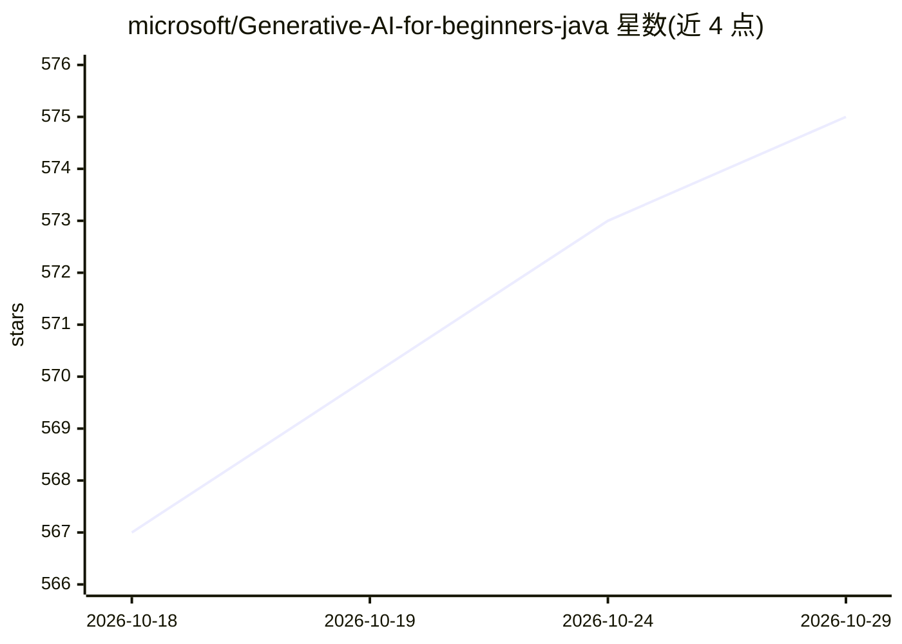

# microsoft/Generative-AI-for-beginners-java

⭐ 575 · Java · MIT · 推送 2026-09-23 · [GitHub](https://github.com/microsoft/Generative-AI-for-beginners-java) · 组织维护

**面向 Java 开发者的生成式 AI 入门课程（5 章，微软维护）**

微软维护的教学课程仓库，通过 Java 讲授生成式 AI 基础：涵盖 LLM/token/embedding 概念、Spring AI 与 OpenAI Java SDK 生态、MCP、提示工程、RAG、Function Calling，以及 Pet Story Generator、Foundry Local Demo、MCP Calculator 等实践项目，并包含 Azure AI Foundry 内容安全与负责任 AI 章节。支持 GitHub Codespaces 在线完成（环境配置约 2 分钟），也可本地 sparse checkout 克隆；提供 50+ 语言翻译，基于 Azure AI Foundry 与 Spring Boot 技术栈。

## 筛选速览

| 维度 | 判定 | 备注 |
|---|---|---|
| AI 角色 | `ai-knowledge` | 知识聚合/清单类 |
| 许可风险 | `permissive` | MIT |
| 部署形态 | `None` |  |
| 模型依赖 | — | README 未给出锁定关系 |
| 硬件要求 | — | 无带数字的原话,不猜 |
| 安装摩擦 | `low` | 无编译、无系统依赖或容器化 |
| 成熟度 | — | 结构信号不足 |

## 能力要点

- 5 章课程路径：概念→环境搭建→核心技术→实践项目→负责任 AI
- 基于 Spring Boot + Spring AI 与官方 OpenAI Java SDK，Azure OpenAI 无密钥认证（Entra ID）
- 实践项目含 RAG、Function Calling、Foundry Local 本地模型、MCP Calculator
- 提供 50+ 语言翻译与 Codespaces 在线开发环境

## 适用场景

- Java 开发者系统学习生成式 AI 开发
- 在 Codespaces 中免本地配置跑通课程示例
- 了解 Spring AI、MCP 与 Azure AI Foundry 的 Java 集成方式

## 场景标签

`教程课程` · 领域:学习与行业

## 证据(README 行号)

> L1: # Generative AI for Beginners - Java Edition
> L45: ### **Chapter 1: Introduction to Generative AI**
> L59: ### **Chapter 3: Core Generative AI Techniques**

## 星数曲线

2026-10-18 567 → 2026-10-29 575（+8）

---
*卡片 v1 · prompt 1.4 · 生成 2026-10-21 · 置信度 high · 依据 README sha `1e0733b3b699` · [字段定义](../../DATASET.md)*
