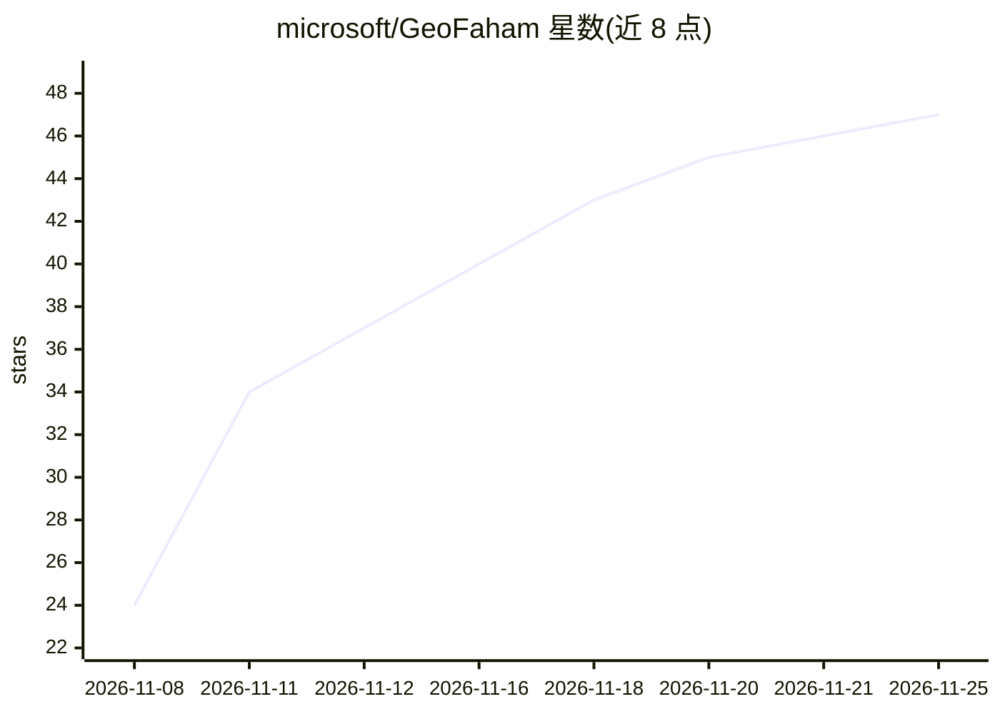

# microsoft/GeoFaham

⭐ 47 · Python · MIT · 推送 2026-11-12 · [GitHub](https://github.com/microsoft/GeoFaham) · 组织维护

**面向灾害响应的自然语言地理空间多智能体分析平台**

Microsoft 维护的地理空间分析平台：用户以自然语言提问，由 Microsoft AutoGen 多智能体架构编排四个专职智能体（空间查询、地图要素、影像检索、栅格分析）完成分析，Orchestrator 维护任务计划并在停滞时修订，Response Store 以文件形式保存中间输出以避免几何/栅格占用模型上下文。数据源整合 PostGIS、OpenStreetMap、卫星影像与栅格计算，评估场景聚焦灾害响应（洪水范围内学校、建筑损毁、火前火后影像）。需自备 PostgreSQL/PostGIS、模型 API key 与 Azure Maps 订阅密钥，git clone 源码安装，MIT 许可。

## 筛选速览

| 维度 | 判定 | 备注 |
|---|---|---|
| AI 角色 | `ai-native` | 本体是模型或模型工具 |
| 许可风险 | `permissive` | MIT |
| 部署形态 | `library` | 以包/库形式分发 |
| 模型依赖 | — | README 未给出锁定关系 |
| 硬件要求 | — | 无带数字的原话,不猜 |
| 安装摩擦 | `low` | 无编译、无系统依赖或容器化 |
| 成熟度 | — | 结构信号不足 |

## 能力要点

- AutoGen 多智能体架构：Orchestrator + 四个专职智能体
- Response Store 以文件与 response ID 传递中间结果，避免大几何数据进入模型上下文
- 整合 PostGIS、OpenStreetMap、卫星影像与栅格计算
- 启动前校验模型配置、PostGIS、必需表与元数据

## 适用场景

- 灾害响应中查询洪水范围内的学校等地理问题
- 火前火后影像对比与燃烧严重度分析
- 以对话方式完成多步地理空间分析工作流

## 场景标签

`多智能体` `数据分析` · 领域:Agent 开发

## 证据(README 行号)

> L11: GeoFaham combines PostGIS records, OpenStreetMap features, satellite imagery, and
> L18: Four agents handle spatial queries, map features, imagery search, and raster
> L19: analysis. An Orchestrator maintains a task plan, tracks progress, and revises the

## 星数曲线

2026-11-08 24 → 2026-11-25 47（+23）

---
*卡片 v1 · prompt 1.4 · 生成 2026-11-18 · 置信度 mid · 依据 README sha `529c7b8b15b8` · [字段定义](../../DATASET.md)*
