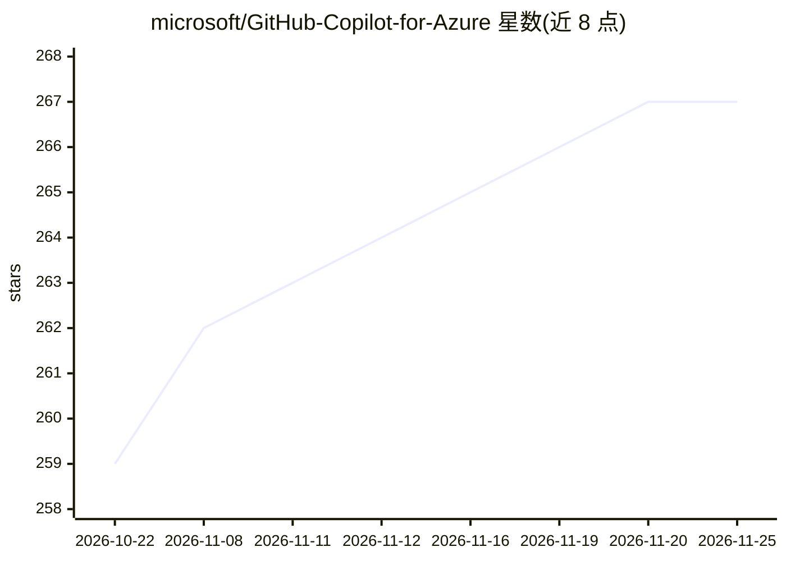

# microsoft/GitHub-Copilot-for-Azure

⭐ 267 · TypeScript · NOASSERTION · 推送 2026-11-24 · [GitHub](https://github.com/microsoft/GitHub-Copilot-for-Azure) · 组织维护

**为 IDE 与 AI 编码客户端接入 Azure 技能的插件集**

微软发布的扩展与插件集合，面向 Visual Studio、VS Code、Copilot CLI、Claude Code、Cursor、Gemini CLI 等客户端，以 Agent Plugins 1.0.0 格式打包 skills、MCP 配置与 hooks，用于在 IDE 内回答 Azure 服务问题并辅助 Azure 管理与开发任务。提供全局/工作区两种技能安装范围，Azure MCP server 默认连接 Azure 公有云，可按主权云（中国/美国政府云）配置 --cloud 参数并认证对应 CLI 工具。前置条件为 Git 与 Node.js。

## 筛选速览

| 维度 | 判定 | 备注 |
|---|---|---|
| AI 角色 | `ai-ecosystem` | LLM/agent 周边工具 |
| 许可风险 | `none` | NOASSERTION |
| 部署形态 | `library` | 以包/库形式分发 |
| 模型依赖 | — | README 未给出锁定关系 |
| 硬件要求 | — | 无带数字的原话,不猜 |
| 安装摩擦 | `low` | 无编译、无系统依赖或容器化 |
| 成熟度 | — | 结构信号不足 |

## 能力要点

- 支持 VS Code、Visual Studio、Claude Code、Copilot CLI、Cursor、Gemini CLI 等多客户端接入
- 以 Agent Plugins 1.0.0 格式提供 plugin.json/mcp.json/skills 与 hooks
- 支持 Azure 中国云与 Azure 美国政府云的 MCP server 配置
- VS Code 中可通过命令面板全局或工作区级安装/卸载 Azure Skills

## 适用场景

- 在 IDE 中询问 Azure 服务相关并获取管理任务辅助
- 让 Claude Code、Cursor 等 AI 编码客户端调用 Azure 技能
- 在主权云环境开发时配置对应云端的 MCP 连接

## 场景标签

 · 领域:开发者工具/云开发

## 证据(README 行号)

> L3: GitHub Copilot for Azure is a set of extensions for Visual Studio, VS Code, and Claude Code designed to streamline t
> L126: root `plugin.json` provides metadata, `mcp.json` provides portable MCP
> L88: By default, the Azure MCP server connects to the Azure Public Cloud. If you use a sovereign cloud (Azure China Clou

## 星数曲线

2026-10-22 259 → 2026-11-25 267（+8）

---
*卡片 v1 · prompt 1.4 · 生成 2026-11-25 · 置信度 mid · 依据 README sha `c9a7d958fa65` · [字段定义](../../DATASET.md)*
