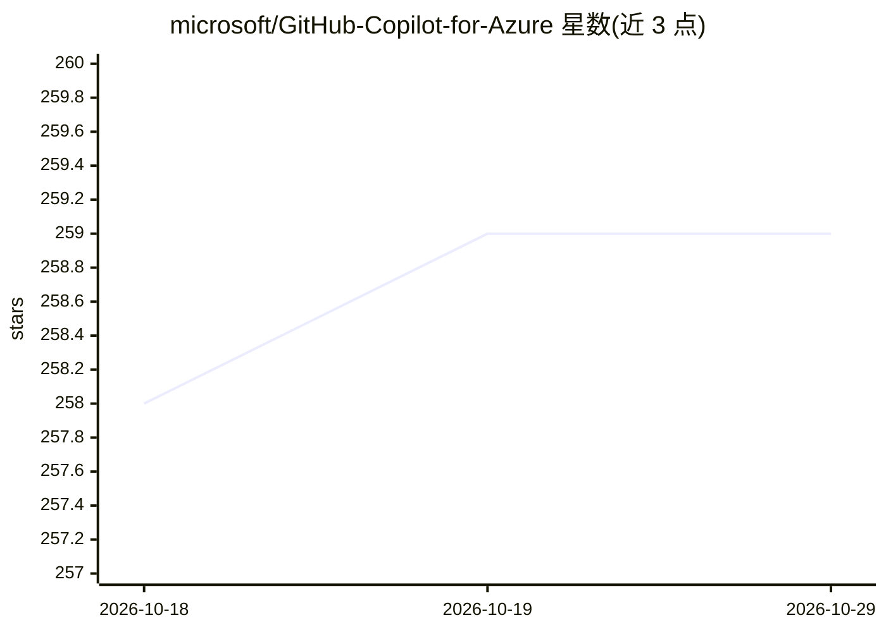

# microsoft/GitHub-Copilot-for-Azure

⭐ 259 · TypeScript · NOASSERTION · 推送 2026-10-28 · [GitHub](https://github.com/microsoft/GitHub-Copilot-for-Azure) · 组织维护

**面向 Azure 开发的 Copilot 扩展集：IDE 内问答与运维辅助**

微软发布的 VS Code、Visual Studio 2022/2026 及 Claude Code 扩展集合，用于在 IDE 内回答 Azure 服务相关问题并辅助 Azure 管理与开发任务。核心机制为随扩展安装的 Azure skills 与 Azure MCP Server（需 Node.js 运行 npx），支持通过编辑 .mcp.json 的 --cloud 参数接入 Azure China Cloud 与 Azure US Government 主权云，并给出 8 个客户端（Copilot CLI、Claude Code、VS Code、IntelliJ、Gemini CLI、Cursor、Codex、Eclipse）的 Skills/MCP/Hooks 支持矩阵。安装经 VS Code 命令面板或 Copilot CLI/Claude Code 的 /plugin 命令完成。

## 筛选速览

| 维度 | 判定 | 备注 |
|---|---|---|
| AI 角色 | `ai-ecosystem` | LLM/agent 周边工具 |
| 许可风险 | `none` | NOASSERTION |
| 部署形态 | `library` | 以包/库形式分发 |
| 模型依赖 | — | README 未给出锁定关系 |
| 硬件要求 | — | 无带数字的原话,不猜 |
| 安装摩擦 | `low` | 无编译、无系统依赖或容器化 |
| 成熟度 | — | 结构信号不足 |

## 能力要点

- 以 skills + Azure MCP Server 形式向 IDE 内 agent 提供 Azure 能力
- 支持 Azure China Cloud 与 Azure US Government 主权云配置
- 提供 8 个客户端的 Skills/MCP/Hooks/Marketplace 支持矩阵
- Visual Studio 2026 中随 Azure & AI 工作负载内置

## 适用场景

- 在 IDE 内向 AI 询问 Azure 服务问题并获得操作辅助
- 让 Claude Code/Copilot CLI 等 agent 执行 Azure 管理与开发任务
- 在 Azure 主权云环境下使用 MCP Server 连接对应云环境

## 场景标签

 · 领域:云计算/开发工具

## 证据(README 行号)

> L3: GitHub Copilot for Azure is a set of extensions for Visual Studio, VS Code, and Claude Code designed to streamline t
> L59: - `@azure: Install Azure Skills Globally` — installs to your home directory (for example `~` on macOS/Linux or `%Us
> L125: |Client|Skills|MCP Servers|Hooks|Marketplace|Manifest|Status|

## 星数曲线

2026-10-18 258 → 2026-10-29 259（+1）

---
*卡片 v1 · prompt 1.4 · 生成 2026-10-22 · 置信度 mid · 依据 README sha `166ab46c8a04` · [字段定义](../../DATASET.md)*
