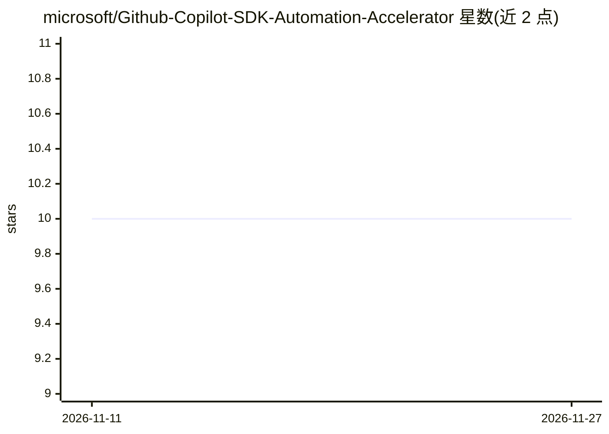

# microsoft/Github-Copilot-SDK-Automation-Accelerator

⭐ 10 · Python · MIT · 推送 2026-03-16 · [GitHub](https://github.com/microsoft/Github-Copilot-SDK-Automation-Accelerator) · 组织维护

**基于 GitHub Copilot SDK 的 AI agent 构建与自动化加速器**

面向开发者的解决方案集合：提供基于 GitHub Copilot SDK 构建、运行和自动化 AI agent 的框架，内置 AKS 监控、代码审查、安全分析三类用例的启动模板，覆盖 Node.js、Python、Go、.NET 四种语言。通过统一 runner 脚本调用各用例，并提供 GitHub Actions、Azure Pipelines、GitLab CI、Bitbucket、CircleCI 五个 CI/CD 平台的工作流配置示例；内置 Azure、AKS、GitHub MCP server 支持。运行前提为 Node.js 20+ 及 GitHub 认证。

## 筛选速览

| 维度 | 判定 | 备注 |
|---|---|---|
| AI 角色 | `ai-ecosystem` | LLM/agent 周边工具 |
| 许可风险 | `permissive` | MIT |
| 部署形态 | `None` |  |
| 模型依赖 | — | README 未给出锁定关系 |
| 硬件要求 | — | 无带数字的原话,不猜 |
| 安装摩擦 | `low` | 无编译、无系统依赖或容器化 |
| 成熟度 | — | 结构信号不足 |

## 能力要点

- 三类预置用例（AKS 监控、代码审查、安全分析）× 四种语言模板
- 五个 CI/CD 平台（GitHub Actions/Azure DevOps/GitLab/Bitbucket/CircleCI）工作流配置
- 内置 Azure、AKS、GitHub MCP server 支持
- 统一 CLI runner 脚本，支持 --init/--diagnose/--list 子命令

## 适用场景

- 在 CI/CD 流水线中定时运行 AKS 集群监控并自动建 issue
- 用 Copilot SDK 搭建自动代码审查或安全扫描 agent
- 按四种语言模板快速初始化自定义 agent 工程

## 场景标签

`工作流自动化` `代码审查` `网络安全` · 领域:效率与自动化

## 证据(README 行号)

> L5: A comprehensive framework for building, running, and automating AI agents using the **GitHub Copilot SDK** across CI
> L115: - **MCP Integration** — Azure, AKS, GitHub MCP server support built-in

## 星数曲线

2026-11-11 10 → 2026-11-27 10（+0）

---
*卡片 v1 · prompt 1.4 · 生成 2026-11-19 · 置信度 high · 依据 README sha `cc90ec8d9d54` · [字段定义](../../DATASET.md)*
