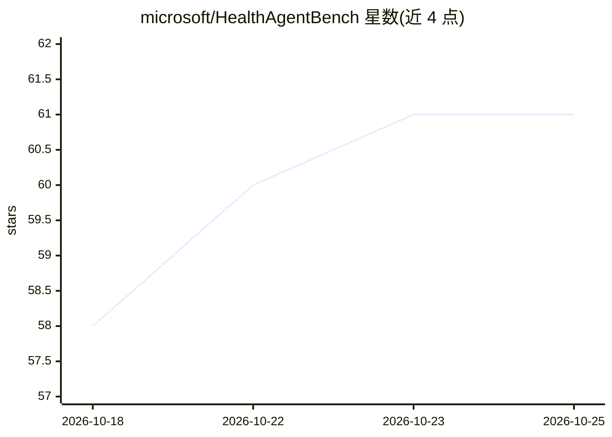

# microsoft/HealthAgentBench

⭐ 61 · Python · MIT · 推送 2026-10-24 · [GitHub](https://github.com/microsoft/HealthAgentBench) · 组织维护

**评测健康医疗 agent 的终端基准套件（54 任务，7 类）**

Microsoft 发布的终端环境基准套件：把 agent 置于终端任务中，要求其检查数据、使用工具、推理并行动以解决临床/生物医学问题，再由任务专属 verifier 打分。覆盖 X 光报告修正、病理肿瘤区域选择、EHR 转换/质检/事件建模、CT 异常分类、临床试验匹配等 7 类 54 个任务，基于 Harbor 执行与评测。安装用 git clone 加 uv sync（需 Python≥3.12），部分任务需申请受限数据集（MIMIC、CT-RATE、EHRSHOT）并配置凭据，评测 agent（Claude Code/Codex）与 LLM 评委均需 API key；数据下载需至少 30GB 磁盘。

## 筛选速览

| 维度 | 判定 | 备注 |
|---|---|---|
| AI 角色 | `ai-ecosystem` | LLM/agent 周边工具 |
| 许可风险 | `permissive` | MIT |
| 部署形态 | `None` |  |
| 模型依赖 | locked-api |  |
| 硬件要求 | — | 无带数字的原话,不猜 |
| 安装摩擦 | `low` | 无编译、无系统依赖或容器化 |
| 成熟度 | — | 结构信号不足 |

## 能力要点

- 7 类 54 个终端任务，含任务专属 verifier 打分
- 基于 Harbor 的统一执行/评测生命周期（agent 运行→verifier→产物）
- 支持按任务、按类别或全套件运行，记录成功率与附加指标
- 覆盖 MIMIC-CXR/IV、CT-RATE、EHRSHOT 等真实临床数据集

## 适用场景

- 评测前沿编码 agent 在医疗任务上的表现与成本
- 按类别（如 X 光报告修正）单独评测 agent 能力
- 基于 Harbor 扩展评测其他 agent

## 场景标签

`模型评测` · 领域:评测与运维

## 证据(README 行号)

> L25: **HealthAgentBench** is a terminal-based benchmark suite for evaluating agents on
> L161: This project uses Harbor as the terminal-task execution and evaluation substrate. Harbor provides a consistent tri

## 星数曲线

2026-10-18 58 → 2026-10-25 61（+3）

---
*卡片 v1 · prompt 1.4 · 生成 2026-10-24 · 置信度 high · 依据 README sha `21679175073b` · [字段定义](../../DATASET.md)*
