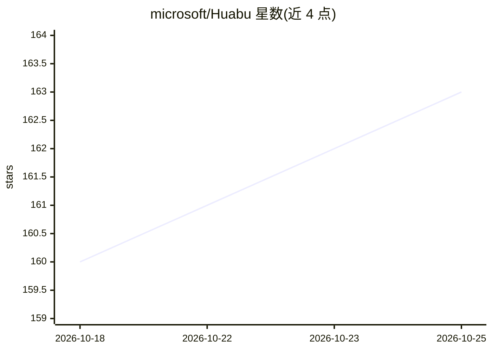

# microsoft/Huabu

⭐ 163 · TypeScript · MIT · 推送 2026-10-25 · [GitHub](https://github.com/microsoft/Huabu) · [官网](https://microsoft.github.io/Huabu/) · 组织维护

**微软的无限画布式思考空间：人与自有 agent 协同整理思路**

Huabu 是一个可视化无限工作界面（桌面应用为主，另有 web 版）：用户将笔记、文档、聊天产出等材料拖入同一 Space，连接自己已在用的 ACP 兼容 agent（保留其模型访问、认证与工具权限），由 agent 帮助整理信息、揭示关联并梳理思路，用户可审阅并控制每一步修改。应用自身不提供 LLM 服务，OCR、图像生成、联网搜索等可选服务需单独配置。面向研究与实验用途发布，不适用于高风险或时效关键决策。桌面安装包覆盖 Apple silicon macOS 与 x64 Windows，也可用 Node.js 24.16+/pnpm 10+ 从源码构建。

## 筛选速览

| 维度 | 判定 | 备注 |
|---|---|---|
| AI 角色 | `ai-ecosystem` | LLM/agent 周边工具 |
| 许可风险 | `permissive` | MIT |
| 部署形态 | `desktop` | 安装包/桌面程序 |
| 模型依赖 | — | README 未给出锁定关系 |
| 硬件要求 | — | 无带数字的原话,不猜 |
| 安装摩擦 | `low` | 无编译、无系统依赖或容器化 |
| 成熟度 | `idea` | |

## 能力要点

- 接入用户已有的 ACP 兼容 agent，保留其模型访问与权限体系
- 无限画布 Space 聚合多源材料，AI 协助组织信息且每次修改可审阅控制
- 应用本身不提供 LLM 服务，模型使用走外部账号与凭据
- 桌面安装包（macOS Apple silicon / Windows x64）与 web/远程访问部署方式齐备

## 适用场景

- 把散落在多个会话与文件中的想法汇聚到一个可视化空间整理
- 让自有 agent 在带上下文关系的画布中协助梳理与研究
- 在桌面或浏览器中搭建人与 agent 协同的思考工作区

## 场景标签

`知识库管理` · 领域:知识与检索

## 证据(README 行号)

> L14: **Bring your own agents.** Huabu is a shared visual interface for the agents you already use. Connect a supported a
> L34: 1. Install and sign in to a supported ACP-compatible agent or adapter on the device where it will run.

## 星数曲线

2026-10-18 160 → 2026-10-25 163（+3）

---
*卡片 v1 · prompt 1.4 · 生成 2026-10-22 · 置信度 mid · 依据 README sha `80b735025bbb` · [字段定义](../../DATASET.md)*
