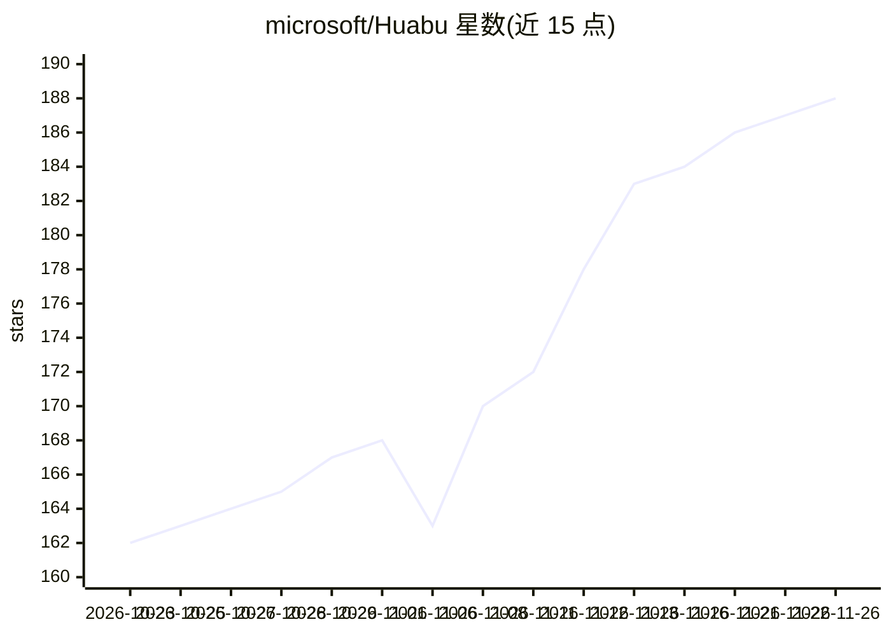

# microsoft/Huabu

⭐ 188 · TypeScript · MIT · 推送 2026-11-25 · [GitHub](https://github.com/microsoft/Huabu) · [官网](https://microsoft.github.io/Huabu/) · 组织维护

**人机共享无限画布：与自己的 AI agent 共同整理思路**

微软开源的研究性项目，提供一块无限工作面（Space），把想法、文件、开放问题与用户已使用的 agent 放在同一可视界面中跨会话保持可见与关联。采用自带 agent（BYOA）机制：连接 ACP 兼容的 agent harness，保留原有模型访问、认证、工具与权限，无需配置内置模型提供方；应用本身不提供 LLM 服务。支持桌面与 Web 两种运行形态，Web 版可远程访问并支持 Disk/SQLite/PostgreSQL 部署。仓库声明仅供研究与实验用途，桌面安装包尚未发布，需从源码构建。

## 筛选速览

| 维度 | 判定 | 备注 |
|---|---|---|
| AI 角色 | `ai-ecosystem` | LLM/agent 周边工具 |
| 许可风险 | `permissive` | MIT |
| 部署形态 | `library` | 以包/库形式分发 |
| 模型依赖 | — | README 未给出锁定关系 |
| 硬件要求 | — | 无带数字的原话,不猜 |
| 安装摩擦 | `low` | 无编译、无系统依赖或容器化 |
| 成熟度 | `idea` | |

## 能力要点

- 自带 agent：连接 ACP 兼容 harness，保留模型访问与权限
- Space 中拖拽整合多来源的笔记、文档与会话输出
- AI 辅助组织信息，用户可审查并控制每个提议的变更
- 桌面与 Web 双形态，Web 支持远程访问与可选 PostgreSQL 部署

## 适用场景

- 把散落在多个会话中的资料拖进一个 Space 统一梳理
- 让已有 agent 在看到材料间关系的前提下继续工作
- 与 agent 协作整理思路并逐项审核其改动

## 场景标签

`知识库管理` · 领域:知识与检索

## 证据(README 行号)

> L12: Huabu gives you an infinite work surface where you and your agents think together. Bring ideas, files, open questio
> L14: **Bring your own agents.** Huabu is a shared visual interface for the agents you already use. Connect a supported a
> L64: Huabu does not provide an LLM service as part of the application. Use of a model or external capability may require

## 星数曲线

2026-10-23 162 → 2026-11-26 188（+26）

---
*卡片 v1 · prompt 1.4 · 生成 2026-11-26 · 置信度 mid · 依据 README sha `04982839e185` · [字段定义](../../DATASET.md)*
