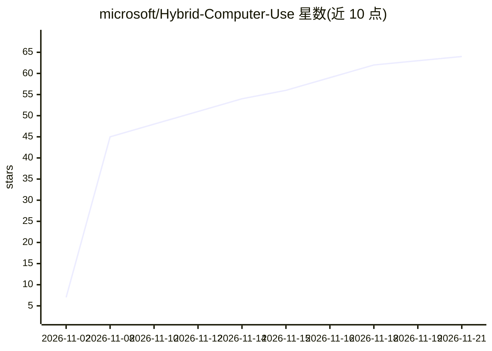

# microsoft/Hybrid-Computer-Use

⭐ 64 · Go · MIT · 推送 2026-11-18 · [GitHub](https://github.com/microsoft/Hybrid-Computer-Use) · [官网](https://microsoft.github.io/Hybrid-Computer-Use/) · 组织维护

**让通用编码 Agent 操作桌面电脑的 MCP 服务器（AX+GUI 双工具）**

微软研究院等机构开源的 Hybrid Computer Use（HCU）：一个名为 computer-use 的 Model Context Protocol 服务器，供 Codex、Claude Code、Gemini CLI、Grok Build 等编码 Agent 通过无障碍树（AT-SPI2/AXUIElement/UI Automation）、截图与键鼠输入操作 Linux、macOS、Windows 桌面。核心机制为 AX（按短引用读写无障碍树、单次调用批量最多 64 个动作并返回 diff）与 GUI（截图、缩放、批量输入）两个工具，且发送输入前校验实时目标与窗口布局，过期动作被拒绝。用 Go 实现核心，各平台有原生 provider，另提供 CLI 与 Python SDK；构建需 make（Go 1.22+，Windows 构建需 .NET 8）。

## 筛选速览

| 维度 | 判定 | 备注 |
|---|---|---|
| AI 角色 | `ai-ecosystem` | LLM/agent 周边工具 |
| 许可风险 | `permissive` | MIT |
| 部署形态 | `None` |  |
| 模型依赖 | — | README 未给出锁定关系 |
| 硬件要求 | — | 无带数字的原话,不猜 |
| 安装摩擦 | `medium` | 含编译或系统依赖之一 |
| 成熟度 | — | 结构信号不足 |

## 能力要点

- MCP 服务器提供 AX 与 GUI 两个工具，Agent 可混合代码、无障碍树与像素三类通道
- AX 单次调用可批量执行最多 64 个动作并带等待，结果返回紧凑 diff
- 发送输入前校验实时目标与窗口布局，检测到桌面已变化则拒绝执行
- 支持 Linux(X11)/macOS 14+/Windows 10/11，CLI 与 Python SDK 共享同一 daemon

## 适用场景

- 让 Codex、Claude Code 等编码 Agent 直接操作我的桌面完成任务
- 通过 CLI 或 Python SDK 做桌面自动化，无需 MCP 客户端
- 复现 OSWorld 等基准评测中的 computer-use 实验

## 场景标签

`GUI 自动化` · 领域:效率与自动化

## 证据(README 行号)

> L20: **Hybrid Computer Use (HCU)** is an open-source Model Context Protocol (MCP)
> L22: Codex, Claude Code, Gemini CLI, and Grok Build operate Linux, macOS, and
> L24: Automation), screenshots, and pointer and keyboard input. It adds two tools,

## 星数曲线

2026-11-02 7 → 2026-11-21 64（+57）

---
*卡片 v1 · prompt 1.4 · 生成 2026-11-18 · 置信度 high · 依据 README sha `a6a4bf7d3297` · [字段定义](../../DATASET.md)*
