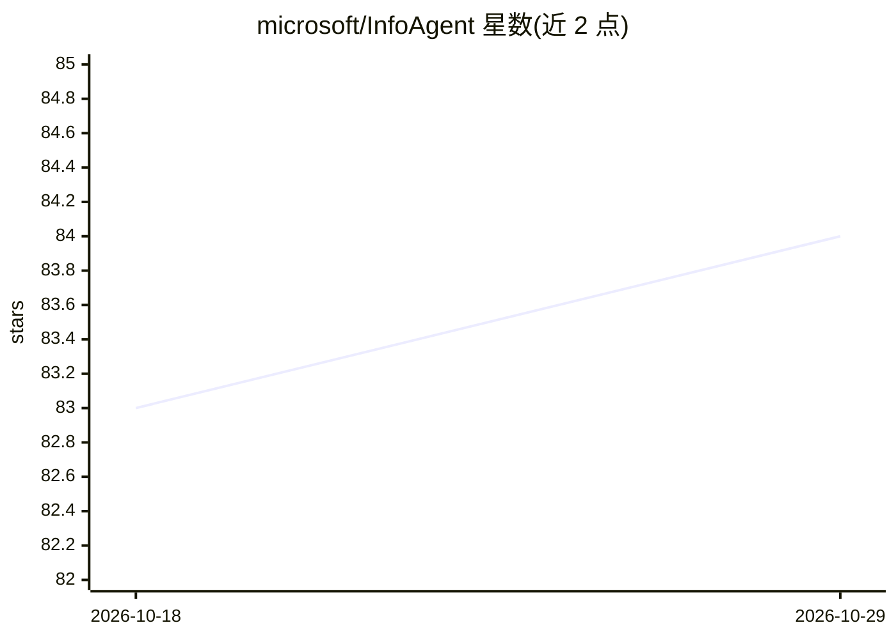

# microsoft/InfoAgent

⭐ 84 · Python · MIT · 推送 2026-02-06 · [GitHub](https://github.com/microsoft/InfoAgent) · 组织维护

**微软发布的自主信息检索/深度搜索 Agent 模型系列**

微软 InfoAgent/RE-TRAC 系列仓库，发布 RE-TRAC 深度搜索 Agent 框架及 Re-TRAC 30B-A3B、Re-TRAC 4B 等检查点。RE-TRAC 通过结构化状态压缩实现跨轨迹探索，支持 prompting 与监督微调两种用法；模型面向自主信息搜寻与深度研究任务，在 BrowseComp/BrowseComp-zh/GAIA/XBench/HLE 上给出评测表。训练数据合成管线目前限于 Wikipedia，README 声明需人工监督部署。

## 筛选速览

| 维度 | 判定 | 备注 |
|---|---|---|
| AI 角色 | `ai-native` | 本体是模型或模型工具 |
| 许可风险 | `permissive` | MIT |
| 部署形态 | `None` |  |
| 模型依赖 | — | README 未给出锁定关系 |
| 硬件要求 | — | 无带数字的原话,不猜 |
| 安装摩擦 | `low` | 无编译、无系统依赖或容器化 |
| 成熟度 | — | 结构信号不足 |

## 能力要点

- 发布 Re-TRAC 30B-A3B 与 Re-TRAC-4B 检查点
- 递归轨迹压缩框架，支持 prompting 与 SFT
- 多基准评测表覆盖开源/闭源模型对比

## 适用场景

- 执行自主信息搜寻与多步深度研究任务
- 在 BrowseComp 等基准上评测长程推理 Agent 模型
- 基于开源检查点做深度搜索 Agent 研究复现

## 场景标签

`Agent 框架` · 领域:Agent 开发

## 证据(README 行号)

> L9: - **InfoAgent** (Preprint 2025) - InfoAgent: Advancing Autonomous Information-Seeking Agents
> L16:  > **Re-TRAC (REcursive TRajectory Compression)**, a recursive framework for deep research agents that enables cros
> L54: - Autonomous information-seeking and deep research tasks.

## 星数曲线

2026-10-18 83 → 2026-10-29 84（+1）

---
*卡片 v1 · prompt 1.4 · 生成 2026-10-24 · 置信度 mid · 依据 README sha `030f5b19a032` · [字段定义](../../DATASET.md)*
