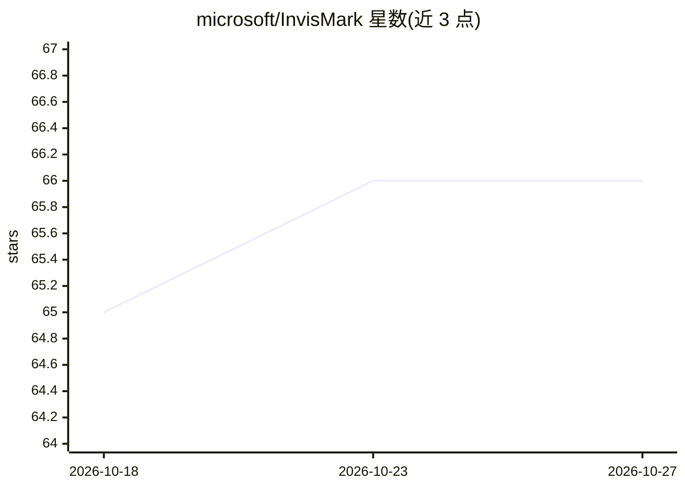

# microsoft/InvisMark

⭐ 66 · Jupyter Notebook · MIT · 推送 2026-04-13 · [GitHub](https://github.com/microsoft/InvisMark) · 组织维护

**AI 生成图像的不可见鲁棒水印方法论文代码**

WACV2025 论文 InvisMark 的源码仓库，为 AI 生成图像添加不可见且鲁棒的水印以标记来源。提供预训练模型权重（100 编码比特、不含纠错码）配合 Demo.ipynb 使用，也支持在自有图像数据集上从头训练水印模型（配置 train.sh 中的路径后运行训练脚本）。安装方式为 pip 安装 requirements.txt 依赖，仓库不含模型权重本体，需从外部链接下载。

## 筛选速览

| 维度 | 判定 | 备注 |
|---|---|---|
| AI 角色 | `ai-native` | 本体是模型或模型工具 |
| 许可风险 | `permissive` | MIT |
| 部署形态 | `library` | 以包/库形式分发 |
| 模型依赖 | — | README 未给出锁定关系 |
| 硬件要求 | — | 无带数字的原话,不猜 |
| 安装摩擦 | `low` | 无编译、无系统依赖或容器化 |
| 成熟度 | — | 结构信号不足 |

## 能力要点

- 提供预训练水印模型权重（100 编码比特、无 ECC）
- 支持在自有数据集上从头训练水印模型
- Demo.ipynb 演示推理流程

## 适用场景

- 为 AI 生成图像嵌入不可见水印以追踪来源
- 复现论文的水印嵌入与提取实验
- 用自己的图像数据集训练定制水印模型

## 场景标签

`图像视频处理` · 领域:感知与多模态

## 证据(README 行号)

> L1: # (WACV2025) InvisMark: Invisible and Robust Watermarking for AI-generated Image Provenance
> L3: This repo contains source code used for the paper: https://arxiv.org/pdf/2411.07795

## 星数曲线

2026-10-18 65 → 2026-10-27 66（+1）

---
*卡片 v1 · prompt 1.4 · 生成 2026-10-24 · 置信度 mid · 依据 README sha `c312a15b1a76` · [字段定义](../../DATASET.md)*
