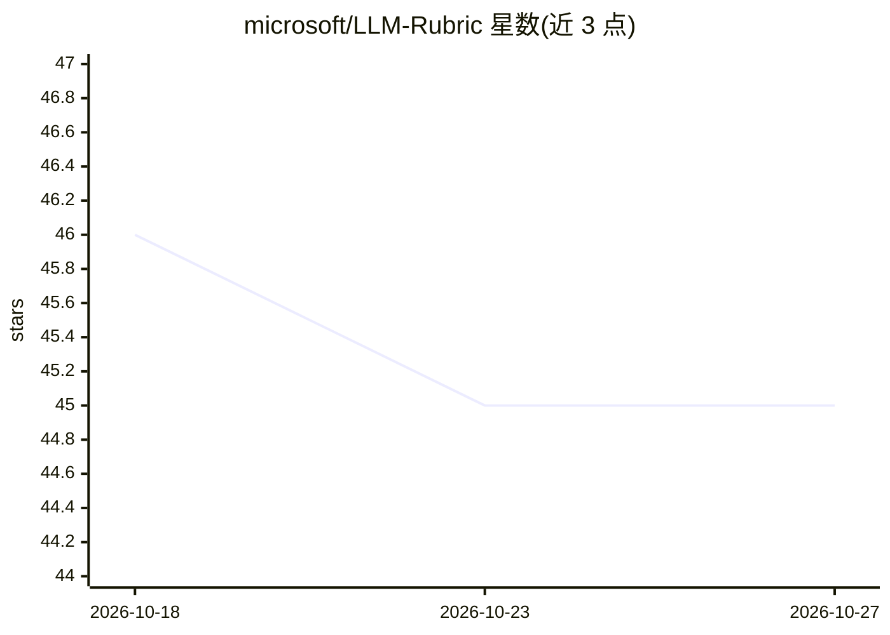

# microsoft/LLM-Rubric

⭐ 45 · Python · MIT · 推送 2026-09-17 · [GitHub](https://github.com/microsoft/LLM-Rubric) · 组织维护

**面向研究者的 LLM 文本多维评估框架（ACL 2024 论文代码）**

LLM-Rubric 论文的官方代码库：用人工构建的 rubric 描述多维度评估标准，LLM 对每个 rubric 问题输出响应分布，再训练含评审者特定与共享参数的小型前馈网络，将多个 LLM 分布组合以预测各人类评审的标注及总体满意度（1-4 分）。论文实验为 TensorFlow 实现，本仓库为 PyTorch 重实现，结果存在少量性能差异。通过 git clone 与 Poetry 安装，提供真实对话数据上的基线、训练与评估脚本。

## 筛选速览

| 维度 | 判定 | 备注 |
|---|---|---|
| AI 角色 | `ai-ecosystem` | LLM/agent 周边工具 |
| 许可风险 | `permissive` | MIT |
| 部署形态 | `library` | 以包/库形式分发 |
| 模型依赖 | — | README 未给出锁定关系 |
| 硬件要求 | — | 无带数字的原话,不猜 |
| 安装摩擦 | `low` | 无编译、无系统依赖或容器化 |
| 成熟度 | — | 结构信号不足 |

## 能力要点

- rubric 问题驱动的 LLM 多维评估
- 小型前馈网络建模评审者特定与评审者无关参数
- 在 223 条真实对话数据上预测人类评审的总体满意度（1-4 分）
- 提供基线计算、超参数搜索、训练与评估脚本

## 适用场景

- 复现或扩展 LLM-Rubric 论文实验
- 用多维 rubric 自动评估对话系统等自然语言文本
- 在自有数据上校准 LLM 评估与人类评审的一致性

## 场景标签

`模型评测` · 领域:评测与运维

## 证据(README 行号)

> L2: LLM-Rubric introduces a framework for the automated evaluation of natural language texts. A manually constructed rub
> L6: **Disclaimer**: this repository was created after the original experimentation for the LLM-Rubric paper. By running 

## 星数曲线

2026-10-18 46 → 2026-10-27 45（-1）

---
*卡片 v1 · prompt 1.4 · 生成 2026-10-25 · 置信度 mid · 依据 README sha `24c9557d46ef` · [字段定义](../../DATASET.md)*
