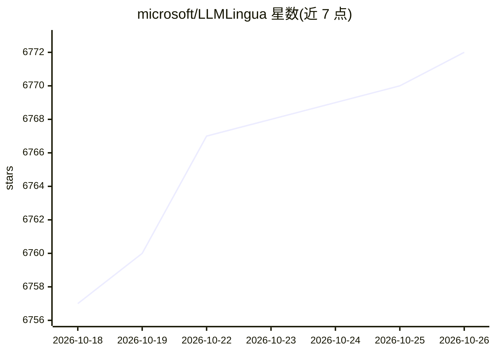

# microsoft/LLMLingua

⭐ 6,772 · Python · MIT · 推送 2026-09-10 · [GitHub](https://github.com/microsoft/LLMLingua) · [官网](https://llmlingua.com/) · 组织维护

**给 LLM 开发者：压缩 prompt 与 KV-Cache 以加速推理、降低成本**

微软开源的 prompt 压缩工具系列（LLMLingua、LongLLMLingua、LLMLingua-2、SecurityLingua）：利用小型语言模型（如 GPT2-small、LLaMA-7B）或 BERT 级编码器识别并移除 prompt 中的非关键 token，实现最高 20x 压缩，支持 KV-Cache 压缩、结构化分段压缩（llmlingua 标签控制压缩率）与自定义数据训练压缩器。以 pip 安装的 Python 库形式提供，已集成入 LangChain、LlamaIndex 与 Prompt flow；附带 RAG、在线会议、CoT、代码等示例。多项工作发表于 EMNLP'23、ACL'24 等会议。

## 筛选速览

| 维度 | 判定 | 备注 |
|---|---|---|
| AI 角色 | `ai-ecosystem` | LLM/agent 周边工具 |
| 许可风险 | `permissive` | MIT |
| 部署形态 | `library` | 以包/库形式分发 |
| 模型依赖 | — | README 未给出锁定关系 |
| 硬件要求 | — | 无带数字的原话,不猜 |
| 安装摩擦 | `low` | 无编译、无系统依赖或容器化 |
| 成熟度 | — | 结构信号不足 |

## 能力要点

- 最高 20x prompt 压缩，无需对 LLM 做额外训练
- LLMLingua-2 采用 GPT-4 数据蒸馏 + BERT 级编码器做任务无关压缩
- 结构化分段压缩：llmlingua 标签按段控制压缩率与开关
- 支持在自定义数据上采集数据并训练压缩器

## 适用场景

- 降低长 prompt 场景下的 API token 成本
- RAG 中压缩检索内容以提升效率
- 长上下文场景缓解 lost in the middle 问题并加速推理
- 通过 SecurityLingua 以压缩方式检测越狱攻击

## 场景标签

`提示工程` · 领域:Agent 开发

## 证据(README 行号)

> L29: LLMLingua utilizes a compact, well-trained language model (e.g., GPT2-small, LLaMA-7B) to identify and remove non-e
> L69: - 📜 **KV-Cache Compression**: Accelerates inference process.
> L117: pip install llmlingua

## 星数曲线

2026-10-18 6,757 → 2026-10-26 6,772（+15）

---
*卡片 v1 · prompt 1.4 · 生成 2026-10-20 · 置信度 high · 依据 README sha `dff51e995732` · [字段定义](../../DATASET.md)*
