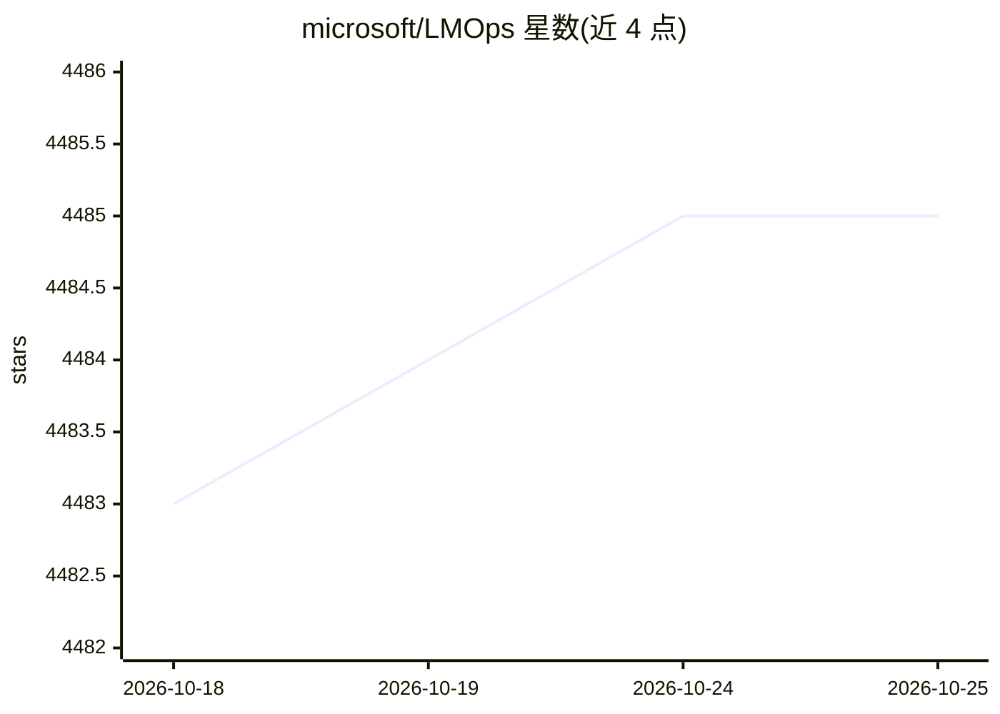

# microsoft/LMOps

⭐ 4,484 · Python · MIT · 推送 2026-09-15 · [GitHub](https://github.com/microsoft/LMOps) · [官网](https://aka.ms/GeneralAI) · 组织维护

**微软的 LLM/基础模型技术集合：提示优化、推理加速等研究项目**

微软发起的研究项目集合，围绕基础模型构建 AI 产品的通用技术，收录多个子方向：Promptist（强化学习自动优化提示）、Structured Prompting（将上下文学习扩展到上千示例）、X-Prompt（超越自然语言的可扩展提示）、LLMA（利用参考文本无损加速 LLM 推理，宣称 2~3 倍提速且无需额外模型），以及上下文学习机理研究。各项目附论文与部分演示，面向科研与开发者；README 未提供本仓库统一的安装命令。

## 筛选速览

| 维度 | 判定 | 备注 |
|---|---|---|
| AI 角色 | `ai-ecosystem` | LLM/agent 周边工具 |
| 许可风险 | `permissive` | MIT |
| 部署形态 | `None` |  |
| 模型依赖 | — | README 未给出锁定关系 |
| 硬件要求 | — | 无带数字的原话,不猜 |
| 安装摩擦 | `low` | 无编译、无系统依赖或容器化 |
| 成熟度 | — | 结构信号不足 |

## 能力要点

- Promptist：基于强化学习的自动提示优化
- LLMA：借助参考文档无损加速 LLM 推理，无需额外模型
- Structured Prompting：上下文学习扩展至 1,000 示例
- 收录多篇 EMNLP 等会议论文

## 适用场景

- 查找提示优化与推理加速相关论文和技术
- 为 RAG、多轮对话场景选择推理加速方案
- 了解上下文学习机理的研究进展

## 场景标签

`科研工具` `强化学习` `提示工程` · 领域:Agent 开发

## 证据(README 行号)

> L2: LMOps is a research initiative on fundamental research and technology for building AI products w/ foundation models,
> L32: ### Promptist: reinforcement learning for automatic prompt optimization
> L66: ### Accelerate LLM Inference with References

## 星数曲线

2026-10-18 4,483 → 2026-10-25 4,485（+2）

---
*卡片 v1 · prompt 1.4 · 生成 2026-10-21 · 置信度 mid · 依据 README sha `d37405163039` · [字段定义](../../DATASET.md)*
