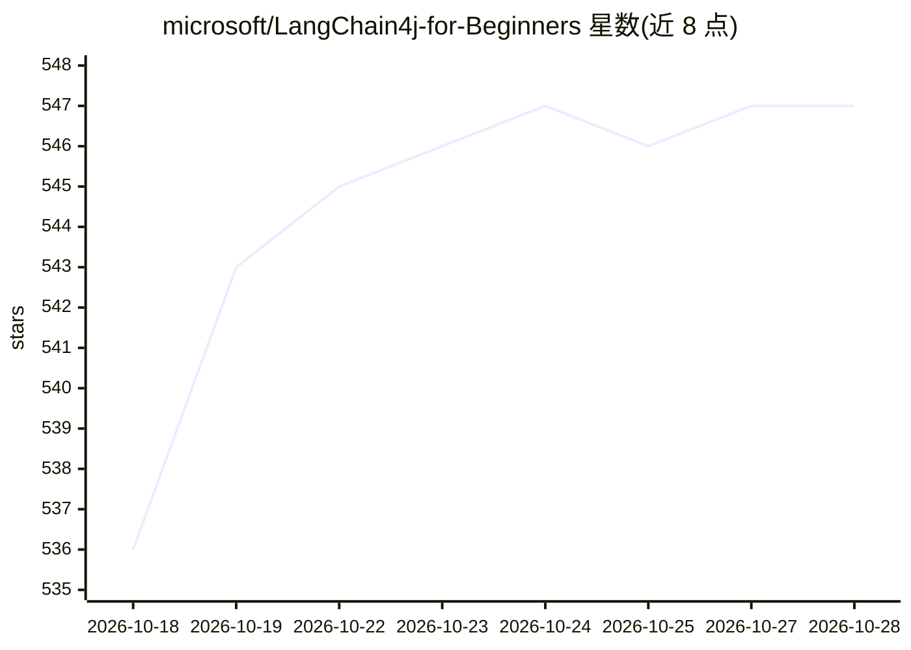

# microsoft/LangChain4j-for-Beginners

⭐ 547 · Java · MIT · 推送 2026-10-08 · [GitHub](https://github.com/microsoft/LangChain4j-for-Beginners) · 组织维护

**微软出品的 LangChain4j 入门课程：从基础聊天到 AI agent**

面向初学者的 Java AI 应用开发课程，以 LangChain4j 框架配合 Azure OpenAI 讲解提示工程、RAG、Tools 与 MCP、AI agents 等模块，每模块配有直播讲解视频。学习路径基于 GitHub Codespaces 开发容器，预配置 GitHub Copilot 用于 AI 结对编程；代码示例附有建议提问。仓库含 50+ 语言翻译（提供 sparse checkout 精简克隆方式），训练需 Azure 账号。MIT 许可。

## 筛选速览

| 维度 | 判定 | 备注 |
|---|---|---|
| AI 角色 | `ai-knowledge` | 知识聚合/清单类 |
| 许可风险 | `permissive` | MIT |
| 部署形态 | `None` |  |
| 模型依赖 | — | README 未给出锁定关系 |
| 硬件要求 | — | 无带数字的原话,不猜 |
| 安装摩擦 | `low` | 无编译、无系统依赖或容器化 |
| 成熟度 | — | 结构信号不足 |

## 能力要点

- 覆盖 Prompt Engineering、RAG、Tools/MCP、AI Agents 等模块的课程体系
- 每模块配有配套直播讲解视频
- Codespaces 开发容器预配置 GitHub Copilot 结对编程
- 提供 50+ 语言翻译与 sparse checkout 精简克隆方式

## 适用场景

- Java 开发者入门 LangChain4j 构建 AI 应用
- 通过 Codespaces 免配置环境跟学课程
- 借助 Copilot 提示深化对示例代码的理解

## 场景标签

`教程课程` · 领域:学习与行业

## 证据(README 行号)

> L5: A course for building AI applications with LangChain4j and Azure OpenAI GPT-5.2, from basic chat to AI agents.
> L41: |01 - Introduction|Getting Started with LangChain4j|
> L46: ## Learning Path

## 星数曲线

2026-10-18 536 → 2026-10-28 547（+11）

---
*卡片 v1 · prompt 1.4 · 生成 2026-10-21 · 置信度 high · 依据 README sha `2d19dab23c87` · [字段定义](../../DATASET.md)*
