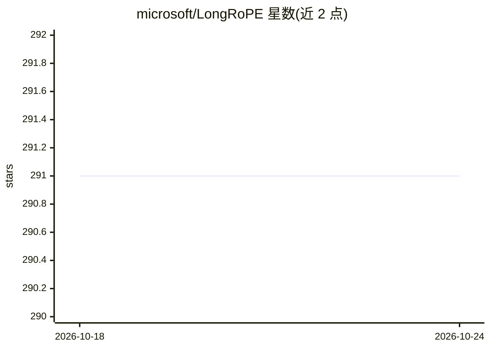

# microsoft/LongRoPE

⭐ 291 · Python · MIT · 推送 2025-10-28 · [GitHub](https://github.com/microsoft/LongRoPE) · 组织维护

**将预训练 LLM 上下文窗口扩展至 2048k 的 RoPE 重缩放方法**

ICML 2024 论文的官方代码，出自微软研究院：通过进化搜索寻找 RoPE 位置嵌入的非均匀重缩放参数，配合渐进式扩展策略（先微调至 256k 再插值到 2048k）并回调整缩放因子以恢复短上下文性能；已集成进 Phi-3 系列。因政策限制仅发布进化搜索部分，微调阶段需自行结合其他训练技术。以源码仓库形式提供，通过 conda+pip 建环境，附 Llama-3-8B 上做 128k 搜索与评测的脚本示例。

## 筛选速览

| 维度 | 判定 | 备注 |
|---|---|---|
| AI 角色 | `ai-ecosystem` | LLM/agent 周边工具 |
| 许可风险 | `permissive` | MIT |
| 部署形态 | `library` | 以包/库形式分发 |
| 模型依赖 | — | README 未给出锁定关系 |
| 硬件要求 | — | 无带数字的原话,不猜 |
| 安装摩擦 | `medium` | 含编译或系统依赖之一 |
| 成熟度 | — | 结构信号不足 |

## 能力要点

- 进化搜索 RoPE 重缩放参数，非微调场景可实现 8x 扩展
- 渐进式扩展策略达到 2048k 上下文窗口
- 8k 长度上回调整缩放因子恢复短上下文性能
- 仅发布进化搜索部分，微调训练部分未放出

## 适用场景

- 为 Llama-3 等模型搜索长上下文的位置编码重缩放参数
- 评测长上下文困惑度与 passkey 准确率
- 复现 LongRoPE 论文的扩展实验流程

## 场景标签

 · 领域:LLM 研究/长上下文扩展

## 证据(README 行号)

> L3: **LongRoPE** is an effective approach that extends LLM context window beyond 2048k tokens by non-uniformly rescaling
> L66: The LongRoPE algorithm is built upon the two forms of non-uniformities in positional interpolation: varying RoPE di
> L71: Due to policy restrictions, only evolution search part is now released. Any LLM training techniques such as EasyCon

## 星数曲线

2026-10-18 291 → 2026-10-24 291（+0）

---
*卡片 v1 · prompt 1.4 · 生成 2026-10-22 · 置信度 mid · 依据 README sha `a8b9bcac57e9` · [字段定义](../../DATASET.md)*
