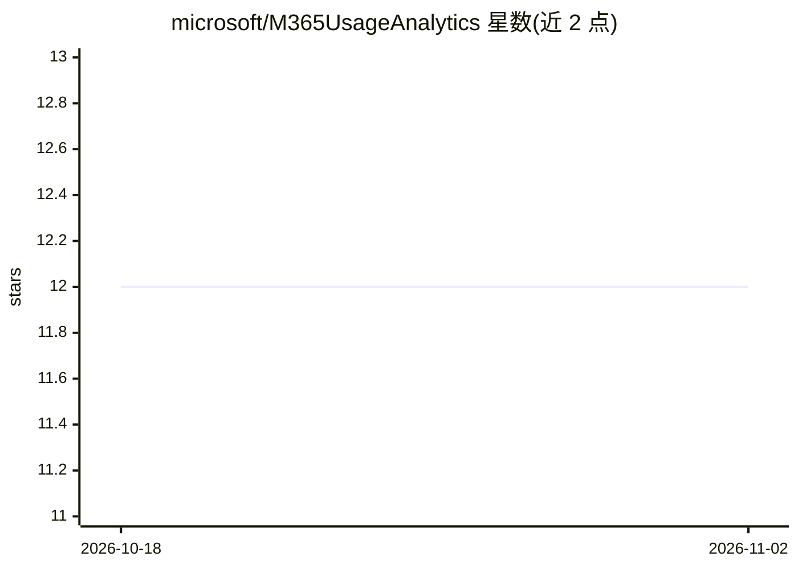

# microsoft/M365UsageAnalytics

⭐ 12 · Python · MIT · 推送 2026-10-30 · [GitHub](https://github.com/microsoft/M365UsageAnalytics) · 组织维护

**Power BI 模板：分析 M365 应用使用与 Copilot 就绪度**

微软维护的 Power BI 模板（.pbit）与配套 PowerShell 脚本：从 Microsoft Purview 统一审计日志和 Entra ID 用户数据导出 CSV，生成 Teams/Outlook/Word/Excel/PowerPoint 使用分析报告，按活跃度分层用户、追踪参与趋势，并基于 Copilot 许可状态给出许可优先级建议。推荐路径为 PAX 一键脚本拉取并处理数据，也支持手动四次 Purview 导出。需要 Power BI Desktop、相应管理员角色与权限，附合成数据的演示 PBIX。

## 筛选速览

| 维度 | 判定 | 备注 |
|---|---|---|
| AI 角色 | `ai-enhanced` | 去掉 AI 部分产品仍成立 |
| 许可风险 | `permissive` | MIT |
| 部署形态 | `library` | 以包/库形式分发 |
| 模型依赖 | — | README 未给出锁定关系 |
| 硬件要求 | — | 无带数字的原话,不猜 |
| 安装摩擦 | `low` | 无编译、无系统依赖或容器化 |
| 成熟度 | — | 结构信号不足 |

## 能力要点

- 从 Purview 审计日志与 Entra 导出构建用户级使用报告
- 按活跃度分层用户并输出参与度指标
- 基于 Entra 许可数据（hasLicense 列）识别 Copilot 许可优先级
- PAX 一键脚本可绕过 Purview 50K/100K 行导出上限并自动汇总

## 适用场景

- IT 管理员分析租户内 M365 各应用的用户采用情况
- 按活跃度分层识别重度/轻度用户与参与趋势
- 为 Copilot 许可证分配排定优先级
- 用演示 PBIX 先预览报告再接入真实租户数据

## 场景标签

 · 领域:企业 IT 分析/BI

## 证据(README 行号)

> L3: ### User-level Microsoft 365 adoption and Copilot readiness, powered by Purview audit logs.
> L17: |**Asset**|Power BI Template (`.pbit`)|
> L83: |**EntraUsers**|User profiles with department, job title, and Copilot license status|

## 星数曲线

2026-10-18 12 → 2026-11-02 12（+0）

---
*卡片 v1 · prompt 1.4 · 生成 2026-11-01 · 置信度 mid · 依据 README sha `d217d42cd907` · [字段定义](../../DATASET.md)*
