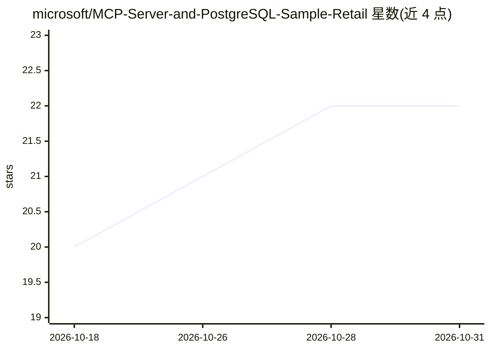

# microsoft/MCP-Server-and-PostgreSQL-Sample-Retail

⭐ 22 · Python · MIT · 推送 2026-10-29 · [GitHub](https://github.com/microsoft/MCP-Server-and-PostgreSQL-Sample-Retail) · 组织维护

**微软零售销售 MCP 服务器示例：教开发者构建数据库接入的 MCP 服务**

Microsoft 维护的示例项目，演示如何构建并部署一个 Model Context Protocol (MCP) 服务器，让 AI 助手通过安全、schema 感知的接口查询 Zava Retail 的 PostgreSQL 销售数据。包含行级安全（RLS）多租户隔离、基于 Azure OpenAI embeddings 的语义商品搜索、容器化部署等特性。仓库附带 12 个模块、约 12-15 小时的分步学习教程。运行依赖 Docker Desktop、Azure CLI 与 Azure 资源部署脚本。

## 筛选速览

| 维度 | 判定 | 备注 |
|---|---|---|
| AI 角色 | `ai-ecosystem` | LLM/agent 周边工具 |
| 许可风险 | `permissive` | MIT |
| 部署形态 | `self-host` | docker 或自建部署 |
| 模型依赖 | locked-api |  |
| 硬件要求 | — | 无带数字的原话,不猜 |
| 安装摩擦 | `low` | 无编译、无系统依赖或容器化 |
| 成熟度 | — | 结构信号不足 |

## 能力要点

- MCP 服务器向 AI 助手提供 PostgreSQL 零售销售数据的查询接口
- 行级安全（RLS）实现多租户数据隔离，店长只能访问本店数据
- 基于 Azure OpenAI embeddings（text-embedding-3-small）的语义商品搜索
- 12 模块分步教程覆盖架构、安全、测试、部署与监控

## 适用场景

- 学习如何构建带数据库集成的 MCP 服务器
- 参考实现多租户安全分析方案的样板代码
- 将 AI 助手接入零售/电商企业数据库做自然语言销售分析

## 场景标签

`教程课程` `语义搜索` · 领域:知识与检索

## 证据(README 行号)

> L28: This sample demonstrates how to build and deploy a comprehensive **Model Context Protocol (MCP) server** that provi
> L49: A Model Context Protocol (MCP) server that provides comprehensive customer sales database access for Zava Retail DI

## 星数曲线

2026-10-18 20 → 2026-10-31 22（+2）

---
*卡片 v1 · prompt 1.4 · 生成 2026-10-28 · 置信度 high · 依据 README sha `ceb6e97b0e5e` · [字段定义](../../DATASET.md)*
