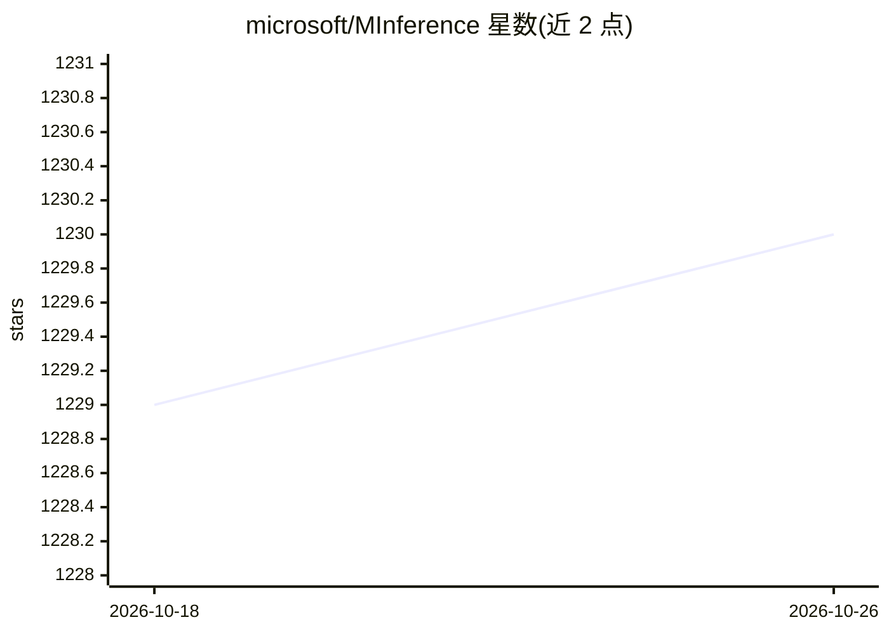

# microsoft/MInference

⭐ 1,230 · Python · MIT · 推送 2026-10-10 · [GitHub](https://github.com/microsoft/MInference) · [官网](https://aka.ms/MInference) · 组织维护

**长上下文 LLM 预填充加速库：动态稀疏注意力降低推理延迟**

微软推出的 LLM 推理加速库，利用注意力动态稀疏的静态模式：离线判定每个注意力头的稀疏模式，在线近似稀疏索引并用定制 kernel 计算注意力，在 A100 上将预填充延迟最高降至 1/10。以 pip 包形式提供，可接入 HF Transformers、vLLM（含 TP）、SGLang，或直接调用稀疏注意力 kernel；另含 SCBench 长上下文评测基准与数据集。支持 Qwen2.5、LLaMA-3.1、GLM-4-1M、Phi-3 等模型。

## 筛选速览

| 维度 | 判定 | 备注 |
|---|---|---|
| AI 角色 | `ai-ecosystem` | LLM/agent 周边工具 |
| 许可风险 | `permissive` | MIT |
| 部署形态 | `library` | 以包/库形式分发 |
| 模型依赖 | local-ok | 支持本地模型 |
| 硬件要求 | — | 无带数字的原话,不猜 |
| 安装摩擦 | `medium` | 含编译或系统依赖之一 |
| 成熟度 | — | 结构信号不足 |

## 能力要点

- 动态稀疏注意力：离线判定模式+在线近似计算，A100 预填充最高 10x 加速
- 可接入 HF Transformers、vLLM、SGLang，亦可单独调用稀疏注意力 kernel
- 覆盖 KV cache 生成/压缩/检索/加载四类长上下文方法（SnapKV、Quest 等）
- 附带 SCBench（12 任务、KV cache 视角）长上下文评测数据集与实验脚本

## 适用场景

- 加速百万 token 级长上下文 LLM 的预填充推理
- 在 vLLM/SGLang 服务中启用稀疏注意力 kernel
- 评测和比较各类长上下文高效注意力与 KV cache 方法

## 场景标签

`推理引擎` `模型评测` · 领域:评测与运维

## 证据(README 行号)

> L34: **MInference 1.0** leverages the dynamic sparse nature of LLMs' attention, which exhibits some static patterns, to 
> L112: > To benefit from fast kernel implementations, we recommend installing **SGLang** or **vLLM**.

## 星数曲线

2026-10-18 1,229 → 2026-10-26 1,230（+1）

---
*卡片 v1 · prompt 1.4 · 生成 2026-10-21 · 置信度 high · 依据 README sha `7b27772a3b7b` · [字段定义](../../DATASET.md)*
