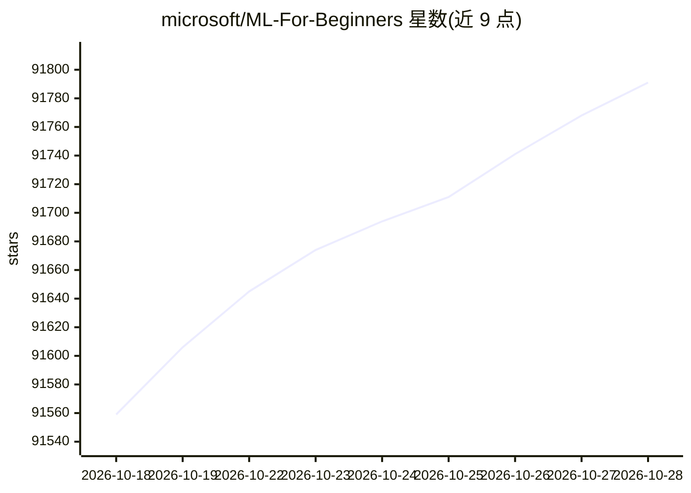

# microsoft/ML-For-Beginners

⭐ 91,827 · Jupyter Notebook · MIT · 推送 2026-10-21 · [GitHub](https://github.com/microsoft/ML-For-Beginners) · 组织维护

**面向初学者的 12 周 26 课经典机器学习课程**

微软 Cloud Advocates 出品的机器学习课程仓库：12 周、26 课、52 个测验，围绕经典机器学习（主要使用 Scikit-learn，不涉及深度学习）。每课含课前/课后测验、讲义、项目步骤、作业与挑战，采用项目式教学法，以世界各地文化数据为案例主题。课程以 Python 为主，部分课提供 R 版本；测验应用可在本地运行或部署到 Azure。提供 50+ 语言翻译及克隆时跳过翻译的 sparse-checkout 方案。

## 筛选速览

| 维度 | 判定 | 备注 |
|---|---|---|
| AI 角色 | `ai-knowledge` | 知识聚合/清单类 |
| 许可风险 | `permissive` | MIT |
| 部署形态 | `None` |  |
| 模型依赖 | — | README 未给出锁定关系 |
| 硬件要求 | — | 无带数字的原话,不猜 |
| 安装摩擦 | `low` | 无编译、无系统依赖或容器化 |
| 成熟度 | — | 结构信号不足 |

## 动量与使用信号

- 维护:`active` — 距上次 push 33.1 天,年发版 0,147 位贡献者
- 涨星:近 1 天 **+37**(自 20261016 起算)
- 平台:WINDOWS / MACOS / LINUX · 协议:MCP

## 能力要点

- 12 周 26 课 52 测验的结构化课程，含 PAT 自评工具
- 主要基于 Scikit-learn 的经典机器学习，覆盖回归/分类/聚类/NLP/时间序列/强化学习
- 50+ 语言自动翻译，提供跳过翻译的 sparse-checkout 克隆方式
- 测验应用可本地运行或部署到 Azure

## 适用场景

- 自学者按周系统学习经典机器学习
- 教师参考课程结构与教学建议开展授课
- 通过各课项目练习 Python/R 数据科学流程

## 场景标签

`教程课程` · 领域:学习与行业

## 证据(README 行号)

> L49: Cloud Advocates at Microsoft are pleased to offer a 12-week, 26-lesson curriculum all about **Machine Learning**. I
> L103: We have chosen two pedagogical tenets while building this curriculum: ensuring that it is hands-on **project-based

## 星数曲线

2026-10-18 91,559 → 2026-10-28 91,791（+232）

---
*卡片 v1 · prompt 1.4 · 生成 2026-10-18 · 置信度 high · 依据 README sha `c8d9cb480c49` · [字段定义](../../DATASET.md)*
