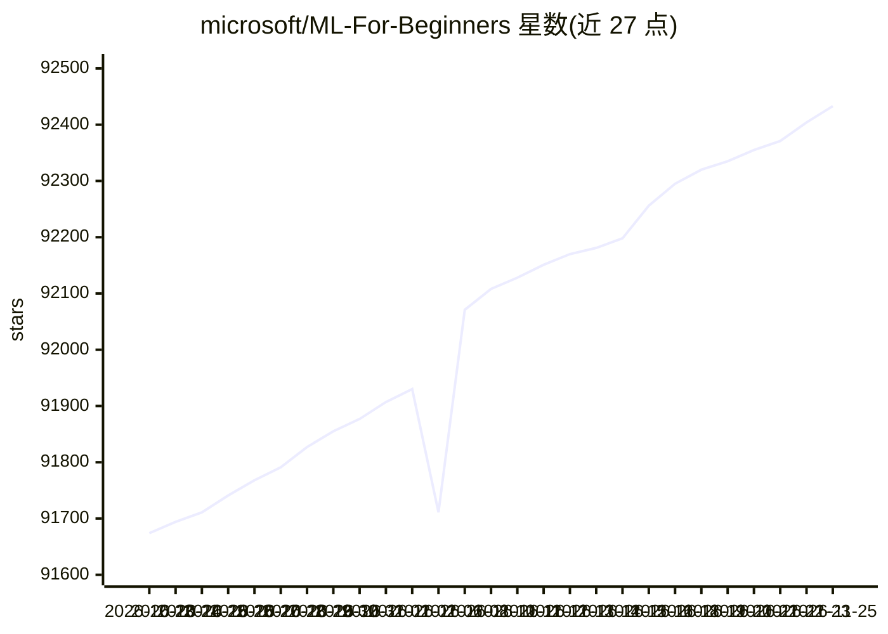

# microsoft/ML-For-Beginners

⭐ 92,433 · Jupyter Notebook · MIT · 推送 2026-11-07 · [GitHub](https://github.com/microsoft/ML-For-Beginners) · 组织维护

**面向初学者的12周26课经典机器学习课程**

Microsoft Cloud Advocates 提供的 12 周、26 课机器学习课程，聚焦使用 Scikit-learn 的经典机器学习，不含深度学习。每课含课前/课后测验、讲义、项目、作业与挑战，采用项目式教学；另含 52 个测验的本地测验应用（可部署到 Azure），Python 为主、部分课程提供 R Markdown 版本，部分课程配视频讲解。学生按 fork-repo 方式自学，教师附使用建议。

## 筛选速览

| 维度 | 判定 | 备注 |
|---|---|---|
| AI 角色 | `ai-knowledge` | 知识聚合/清单类 |
| 许可风险 | `permissive` | MIT |
| 部署形态 | `None` |  |
| 模型依赖 | — | README 未给出锁定关系 |
| 硬件要求 | — | 无带数字的原话,不猜 |
| 安装摩擦 | `low` | 无编译、无系统依赖或容器化 |
| 成熟度 | — | 结构信号不足 |

## 动量与使用信号

- 维护:`active` — 距上次 push 33.1 天,年发版 0,147 位贡献者
- 涨星:近 1 天 **+37**(自 20261016 起算)
- 平台:WINDOWS / MACOS / LINUX · 协议:MCP

## 能力要点

- 12 周 26 课项目式课程，覆盖回归、分类、聚类、NLP、时间序列、强化学习
- 52 个三题测验，测验应用可本地运行或部署 Azure
- Python 为主，部分课程提供 R（.rmd）版本
- 50+ 语言翻译，可用 sparse checkout 克隆以减小体积

## 适用场景

- 系统自学经典机器学习并动手完成项目
- 教师拿来直接开课或改造教学
- 按回归/分类等主题查找带数据集的项目练习

## 场景标签

`教程课程` · 领域:学习与行业

## 证据(README 行号)

> L49: Cloud Advocates at Microsoft are pleased to offer a 12-week, 26-lesson curriculum all about **Machine Learning**. I
> L51: Travel with us around the world as we apply these classic techniques to data from many areas of the world. Each les
> L103: We have chosen two pedagogical tenets while building this curriculum: ensuring that it is hands-on **project-based

## 星数曲线

2026-10-23 91,674 → 2026-11-25 92,433（+759）

---
*卡片 v1 · prompt 1.4 · 生成 2026-11-22 · 置信度 high · 依据 README sha `b58dad5c0e7a` · [字段定义](../../DATASET.md)*
