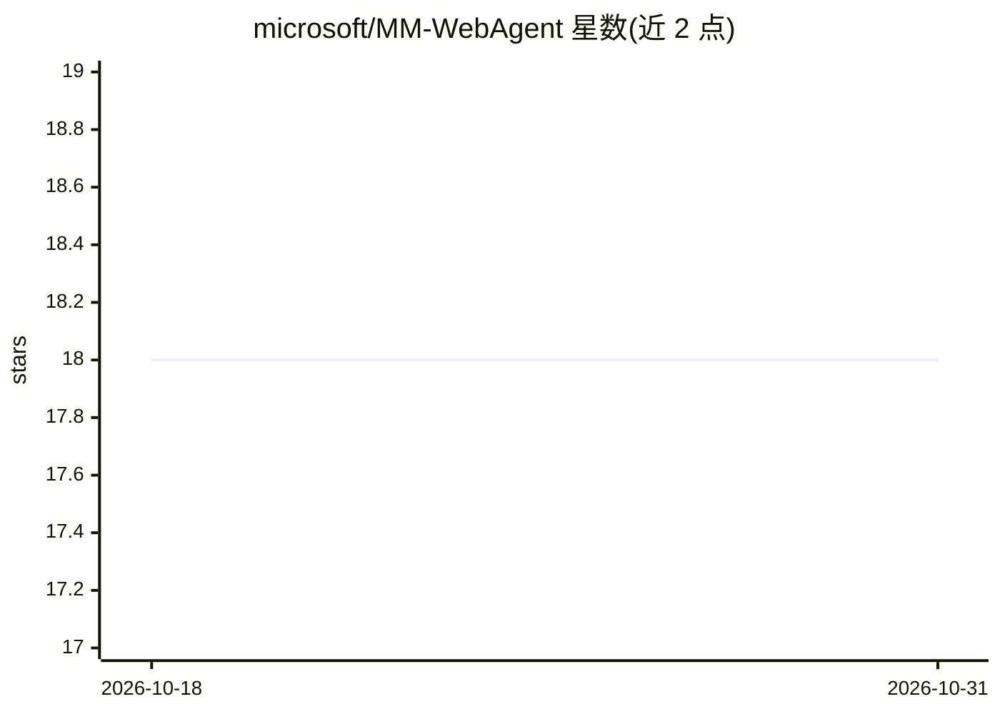

# microsoft/MM-WebAgent

⭐ 18 · Python · MIT · 推送 2026-05-17 · [GitHub](https://github.com/microsoft/MM-WebAgent) · [官网](http://aka.ms/mm-webagent) · 组织维护

**层级式多模态网页生成 agent 框架，附评测基准**

将网页创建建模为自动化设计流程的层级 agent 框架：先做页面级全局规划，再在上下文约束下生成图像、视频、图表等局部多模态元素（协调 AIGC 工具），最后经多层级反思（全局/图像/视频/图表各默认 3 轮）精修整页，输出 main.html 与生成日志。配套 MM-WebGEN-Bench 基准（120 条提示，11 场景/11 风格）。以 Python 源码 + Conda 环境运行，需 OpenAI API key、Playwright、Node.js 与网络访问。

## 筛选速览

| 维度 | 判定 | 备注 |
|---|---|---|
| AI 角色 | `ai-native` | 本体是模型或模型工具 |
| 许可风险 | `permissive` | MIT |
| 部署形态 | `library` | 以包/库形式分发 |
| 模型依赖 | — | README 未给出锁定关系 |
| 硬件要求 | — | 无带数字的原话,不猜 |
| 安装摩擦 | `low` | 无编译、无系统依赖或容器化 |
| 成熟度 | — | 结构信号不足 |

## 能力要点

- 层级流程：全局规划→局部多模态生成→多级反思精修
- 协调 AIGC 工具生成图像/视频/图表与页面布局
- MM-WebGEN-Bench：120 条提示、11 场景、11 视觉风格
- 多层级评测（global/image/video/chart）可配置轮次

## 适用场景

- 研究者复现多模态网页生成的层级 agent 实验
- 用基准评测不同模型的网页生成效果
- 基于该流程生成含图像/视频/图表的完整网页

## 场景标签

`Agent 框架` `模型评测` `多模态` · 领域:Agent 开发

## 证据(README 行号)

> L11: **MM-WebAgent** is a hierarchical agentic framework for **multimodal webpage generation**. Instead of treating webp
> L24: To support research in this direction, we also introduce **MM-WebGEN-Bench**, a multi-level benchmark for evaluatin

## 星数曲线

2026-10-18 18 → 2026-10-31 18（+0）

---
*卡片 v1 · prompt 1.4 · 生成 2026-10-29 · 置信度 mid · 依据 README sha `7b6a934f0618` · [字段定义](../../DATASET.md)*
