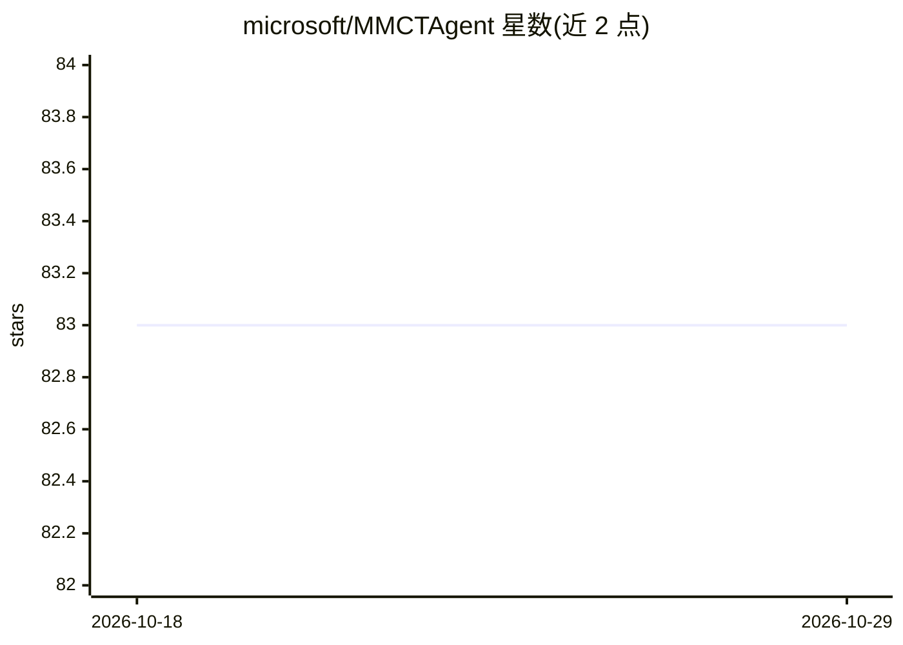

# microsoft/MMCTAgent

⭐ 83 · Python · MIT · 推送 2026-08-26 · [GitHub](https://github.com/microsoft/MMCTAgent) · 组织维护

**面向复杂视觉推理的多模态批判性思维 Agent 框架**

微软研究团队开发的 Python 框架，将视频/图像转化为可查询的时序知识图谱（Neo4j），并提供两种编排方式：自主多 Agent 团队（Planner/Video/Image）与确定性状态机流水线，结合自我反思、任务特定评估与视觉 critic 做批判性推理。图像管线含 OCR、目标检测、场景识别等工具；支持 Azure OpenAI、Azure Speech、Whisper 等提供商，内置 MCP 服务器，可自定义流水线步骤。需 FFmpeg、Neo4j 等外部依赖，声明为活跃研究阶段、代码可能演进。

## 筛选速览

| 维度 | 判定 | 备注 |
|---|---|---|
| AI 角色 | `ai-ecosystem` | LLM/agent 周边工具 |
| 许可风险 | `permissive` | MIT |
| 部署形态 | `library` | 以包/库形式分发 |
| 模型依赖 | locked-api |  |
| 硬件要求 | — | 无带数字的原话,不猜 |
| 安装摩擦 | `medium` | 含编译或系统依赖之一 |
| 成熟度 | `idea` | |

## 能力要点

- 视频→Neo4j 时序知识图谱的结构化摄取管线
- Swarm 多 Agent 与确定性 Pipeline 双编排模式
- 图像推理管线含 OCR、目标检测、场景识别、ViT 工具
- 提供商无关架构（LLM/转录/存储可切换）与内置 MCP 服务器

## 适用场景

- 对大量视频/图像建立知识图谱并做问答
- 构建带自我反思与验证的视觉推理应用
- 通过 MCP 将视觉推理管线暴露给外部 AI 客户端

## 场景标签

`Agent 框架` `多智能体` `知识图谱` `多模态` · 领域:Agent 开发

## 证据(README 行号)

> L7:  Multi-Modal Critical Thinking Agent Framework for Complex Visual Reasoning
> L25: - **🧠 Self Reflection Framework**: MMCTAgent emulates iteratively analyzing multi-modal information, decomposing co
> L133: Query your video knowledge graph using either agentic swarm or deterministic state modes.

## 星数曲线

2026-10-18 83 → 2026-10-29 83（+0）

---
*卡片 v1 · prompt 1.4 · 生成 2026-10-24 · 置信度 high · 依据 README sha `6a21b9cfb744` · [字段定义](../../DATASET.md)*
