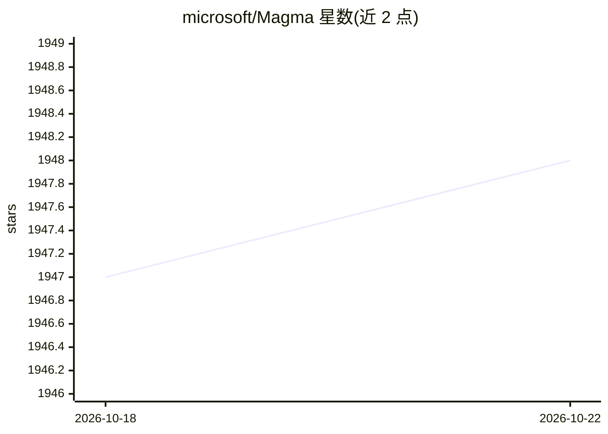

# microsoft/Magma

⭐ 1,948 · Python · MIT · 推送 2026-03-03 · [GitHub](https://github.com/microsoft/Magma) · 组织维护

**多模态 AI Agent 基础模型：图像视频理解与目标驱动动作生成**

Microsoft Research 等机构发布的 CVPR 2025 论文配套模型与代码库。Magma 在单一模型中提供图像/视频理解、UI 导航与机器人操作等能力，可生成目标驱动的视觉规划与动作。预训练采用无标注野外视频（经去摄像机运动处理转为动作监督）加既有标注数据，以 Set-of-Mark 与 Trace-of-Mark 作为统一文本/图像/动作三模态训练的辅助任务。仓库提供推理、训练（Magma-8B 于 Magma-820K）、SoM/ToM 生成及 lmms-eval、SimplerEnv 评测代码，模型托管于 Hugging Face 与 Azure AI Foundry。限制：需定制版 transformers 修复 ConvNext gamma 参数加载 bug。

## 筛选速览

| 维度 | 判定 | 备注 |
|---|---|---|
| AI 角色 | `ai-native` | 本体是模型或模型工具 |
| 许可风险 | `permissive` | MIT |
| 部署形态 | `library` | 以包/库形式分发 |
| 模型依赖 | — | README 未给出锁定关系 |
| 硬件要求 | — | 无带数字的原话,不猜 |
| 安装摩擦 | `medium` | 含编译或系统依赖之一 |
| 成熟度 | — | 结构信号不足 |

## 能力要点

- 单一模型覆盖图像/视频理解、UI 导航、机器人操作
- Set-of-Mark / Trace-of-Mark 统一文本-图像-动作三模态预训练
- 提供训练代码与 Magma-820K 微调流程
- 支持 bitsandbytes 4-bit 量化推理（峰值显存 7GB）

## 适用场景

- 加载模型做多模态理解与 Agent 动作规划研究
- 在 UI 导航或机器人操作任务上微调与评测
- 复现论文的 SoM/ToM 预训练数据生成流程

## 场景标签

`多模态` · 领域:感知与多模态

## 证据(README 行号)

> L71: **Magma is a foundation model for multimodal AI agents**. As the bedrock for multimodal agentic models, it should p
> L76: With this in mind, we developed a new pretraining data, which mostly consists of unlabeled videos in the wild plus 
> L35: * **Versatile Capabilities:** Magma as a single model not only possesses generic image and videos understanding abi

## 星数曲线

2026-10-18 1,947 → 2026-10-22 1,948（+1）

---
*卡片 v1 · prompt 1.4 · 生成 2026-10-21 · 置信度 high · 依据 README sha `b66e4ffb8d9f` · [字段定义](../../DATASET.md)*
