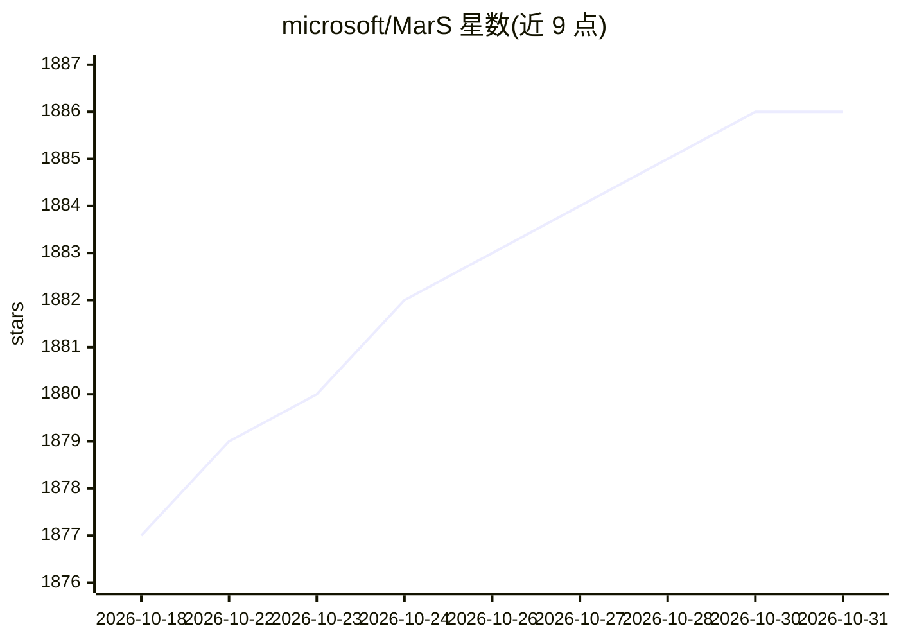

# microsoft/MarS

⭐ 1,886 · Python · MIT · 推送 2026-09-28 · [GitHub](https://github.com/microsoft/MarS) · 组织维护 · 中文 README

**微软开源的生成式金融市场模拟引擎：订单级仿真与预测**

基于生成式基础模型的金融市场仿真引擎：通过 order model 生成订单事件（价格、数量、方向），市场行为由订单交互涌现，支持 11 项风格化事实评估、以仿真做预测、市场冲击分析和 Streamlit 交互演示。已发布 2M/5M/10M 三个订单模型（更大模型待审批），用 Ray Serve 部署服务，论文被 ICLR 2025 接收。强烈建议用 Docker 运行，因系统依赖与 CUDA 需求不支持直接安装；实验中曾用 128 GPU 并行仿真，生产部署需大量优化与订单级历史数据。

## 筛选速览

| 维度 | 判定 | 备注 |
|---|---|---|
| AI 角色 | `ai-native` | 本体是模型或模型工具 |
| 许可风险 | `permissive` | MIT |
| 部署形态 | `self-host` | docker 或自建部署 |
| 模型依赖 | — | README 未给出锁定关系 |
| 硬件要求 | — | 无带数字的原话,不猜 |
| 安装摩擦 | `low` | 无编译、无系统依赖或容器化 |
| 成熟度 | — | 结构信号不足 |

## 能力要点

- 订单级轨迹生成：模拟订单事件而非直接预测价格
- 11 项风格化事实中 9 项在历史与仿真数据中均复现
- 已发布 2M/5M/10M 三个 order model，经 Ray Serve 部署
- 提供风格化事实报告、预测、市场冲击分析与 Streamlit 交互演示

## 适用场景

- 我想在仿真市场中研究交易策略的市场冲击
- 我想通过多次订单级仿真探索未来价格的可能分布
- 我想验证仿真市场数据是否符合真实市场的风格化事实

## 场景标签

`金融量化` · 领域:学习与行业

## 证据(README 行号)

> L23: Welcome to our project! We are excited to release the foundational code and tools designed for market simulation an
> L255: 1. **Order-Level Simulation**: Instead of predicting prices directly, MarS generates individual order events with 

## 星数曲线

2026-10-18 1,877 → 2026-10-31 1,886（+9）

---
*卡片 v1 · prompt 1.4 · 生成 2026-10-21 · 置信度 high · 依据 README sha `79d5f76197c7` · [字段定义](../../DATASET.md)*
