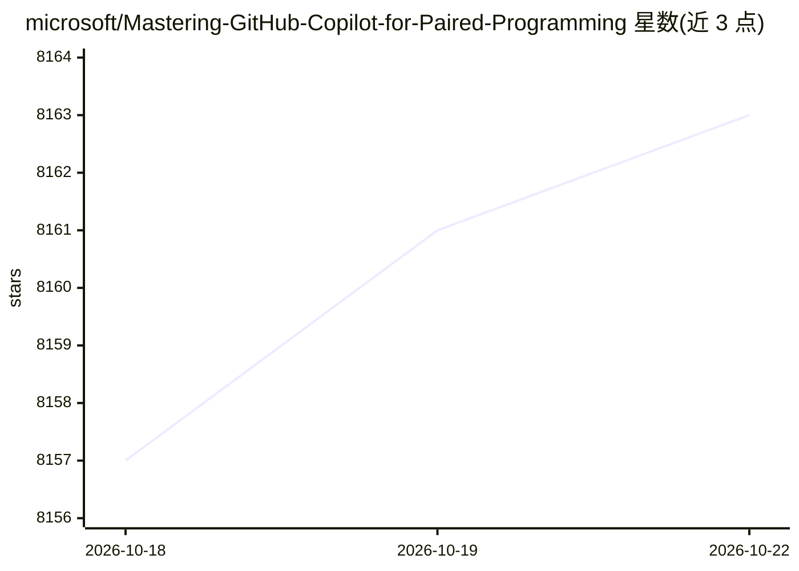

# microsoft/Mastering-GitHub-Copilot-for-Paired-Programming

⭐ 8,163 · Python · MIT · 推送 2026-09-16 · [GitHub](https://github.com/microsoft/Mastering-GitHub-Copilot-for-Paired-Programming) · 组织维护

**微软出品的 GitHub Copilot AI 结对编程多模块课程**

面向各水平开发者的 10 小时多模块免费课程，教授 GitHub Copilot 及其 Agent Mode、Copilot Chat、Copilot CLI、Copilot Coding Agent、Copilot for Azure 的使用，内容覆盖自然语言提示词、代码生成、测试、迭代、MCP 集成、遗留项目升级、跨语言迁移与数据科学工作流。每课含 README 讲义、练习挑战与扩展资源，分初级、中级、高级三档，共约 15 课。使用需将课程 fork 到自己 GitHub 账号并持有 Copilot 订阅（有免费注册入口）。

## 筛选速览

| 维度 | 判定 | 备注 |
|---|---|---|
| AI 角色 | `ai-knowledge` | 知识聚合/清单类 |
| 许可风险 | `permissive` | MIT |
| 部署形态 | `None` |  |
| 模型依赖 | — | README 未给出锁定关系 |
| 硬件要求 | — | 无带数字的原话,不猜 |
| 安装摩擦 | `low` | 无编译、无系统依赖或容器化 |
| 成熟度 | — | 结构信号不足 |

## 能力要点

- 10 小时多模块课程，涵盖 Agent Mode、CLI、Coding Agent、MCP 集成
- 每课含讲义、练习挑战与扩展资源链接
- 课程分 Beginner/Intermediate/Advanced 三档，覆盖 JS/Python/C#/SQL
- 附 Azure/Startups 免费额度申请指引

## 适用场景

- 系统学习 GitHub Copilot 与 Agent 模式的开发工作流
- 练习用 Copilot 做代码生成、测试、遗留项目升级与跨语言迁移
- 了解 MCP 服务器与 Copilot 的集成方式

## 场景标签

`教程课程` · 领域:学习与行业

## 证据(README 行号)

> L4: Unlock the next generation of collaborative coding with our newly updated, in-depth course: Mastering GitHub Copilot
> L33: ## 📂 Each lesson includes:
> L41: # Beginner

## 星数曲线

2026-10-18 8,157 → 2026-10-22 8,163（+6）

---
*卡片 v1 · prompt 1.4 · 生成 2026-10-20 · 置信度 high · 依据 README sha `1d02a9f7ed1c` · [字段定义](../../DATASET.md)*
