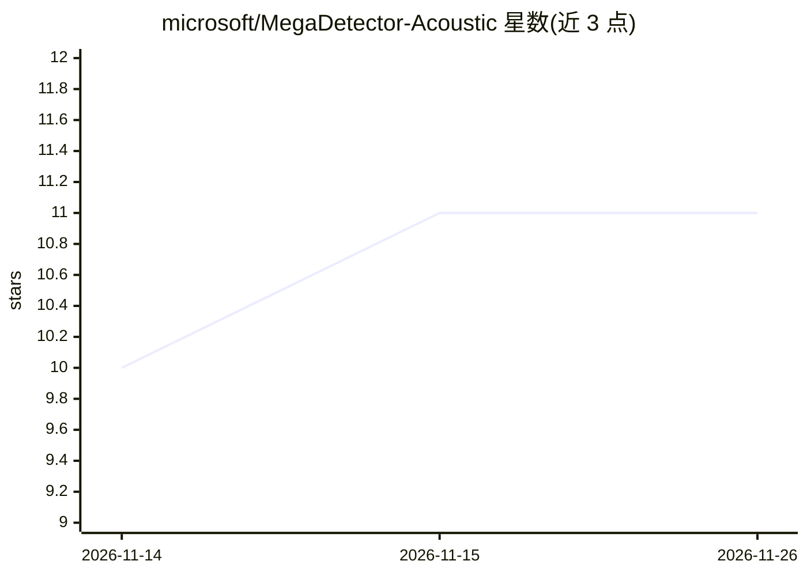

# microsoft/MegaDetector-Acoustic

⭐ 11 · Python · MIT · 推送 2026-11-20 · [GitHub](https://github.com/microsoft/MegaDetector-Acoustic) · [官网](https://microsoft.github.io/MegaDetector-Acoustic/) · 组织维护

**为保护研究者提供被动声学录音的物种检测与分类工具**

微软 AI for Good Lab 的生物声学监测模型仓库，提供 CLI 脚本与训练工具，从被动声学录音中进行野生动物声音检测与分类。核心深度学习基础设施（模型、数据集、频谱图工具）由 PyTorch-Wildlife 提供，该框架已不再维护。支持 Mel 频谱图生成（GPU 加速）、基于 ResNet 的二分类与多类别物种分类、YAML 域配置、长录音滑窗推理，并提供从原始音频到 CSV 输出的端到端流水线，附带 ONNX 预训练模型与 demo notebook。

## 筛选速览

| 维度 | 判定 | 备注 |
|---|---|---|
| AI 角色 | `ai-native` | 本体是模型或模型工具 |
| 许可风险 | `permissive` | MIT |
| 部署形态 | `library` | 以包/库形式分发 |
| 模型依赖 | — | README 未给出锁定关系 |
| 硬件要求 | — | 无带数字的原话,不猜 |
| 安装摩擦 | `low` | 无编译、无系统依赖或容器化 |
| 成熟度 | — | 结构信号不足 |

## 能力要点

- 基于 ResNet 骨干的二分类与多类别物种分类
- 长音频滑窗推理与端到端音频→预测→CSV 流水线
- GPU 加速的 Mel 频谱图生成与 YAML 域配置
- 提供 ONNX 预训练模型（Zenodo 下载）与端到端 demo notebook

## 适用场景

- 从被动声学监测录音中检测鸟类等野生动物物种
- 在自己的声学数据集上微调训练物种分类模型
- 对长时段野外录音批量跑推理并输出 CSV 结果

## 场景标签

`微调` · 领域:训练与推理

## 证据(README 行号)

> L3: Microsoft AI for Good Lab's open-source AI for bioacoustic biodiversity monitoring — audio-based species detection a
> L28: MegaDetector-Acoustic provides CLI scripts and training tools for audio-based wildlife detection and classification
> L34: - Binary and multiclass species classification using ResNet backbones

## 星数曲线

2026-11-14 10 → 2026-11-26 11（+1）

---
*卡片 v1 · prompt 1.4 · 生成 2026-11-18 · 置信度 mid · 依据 README sha `967160634990` · [字段定义](../../DATASET.md)*
