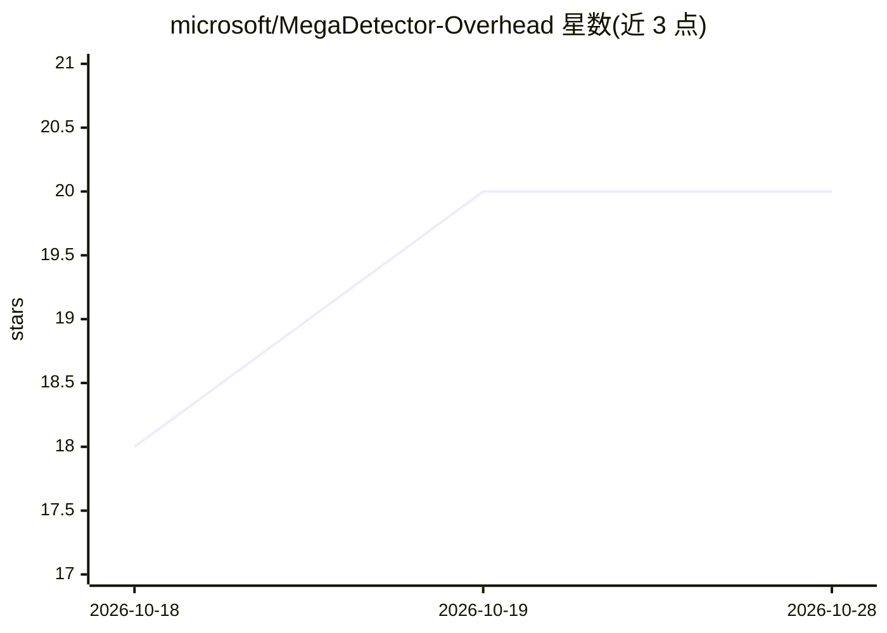

# microsoft/MegaDetector-Overhead

⭐ 20 · Python · MIT · 推送 2026-10-24 · [GitHub](https://github.com/microsoft/MegaDetector-Overhead) · [官网](https://microsoft.github.io/Biodiversity/) · 组织维护

**微软开源的航拍野生动物点检测模型（OWL 系列）**

面向无人机/航拍影像的野生动物点检测模型库，属于 PyTorch-Wildlife/MegaDetector 生态。提供 OWL-C（DLA-34，HerdNet 检测分支）、OWL-T（DLA-34+Swin 多尺度残差）与 OWL-D（DINOv3 ViT+DPT 解码器，S/B/L/H 多尺寸）模型及训练、评测、推理全套代码；OWL-D 约 3.5 GB 检查点含冻结 DINOv3 backbone，推理需兼容 CUDA GPU，也支持 CPU 上运行 OWL-C。环境用 uv 管理，预训练权重发布在 Zenodo。给生态保护研究者与开发者使用。

## 筛选速览

| 维度 | 判定 | 备注 |
|---|---|---|
| AI 角色 | `ai-native` | 本体是模型或模型工具 |
| 许可风险 | `permissive` | MIT |
| 部署形态 | `desktop` | 安装包/桌面程序 |
| 模型依赖 | — | README 未给出锁定关系 |
| 硬件要求 | — | 无带数字的原话,不猜 |
| 安装摩擦 | `medium` | 含编译或系统依赖之一 |
| 成熟度 | — | 结构信号不足 |

## 能力要点

- OWL-C/T/D 三族模型，OWL-D 用 DINOv3 基础模型编码器
- 训练、评测、推理完整流程（Hydra 配置 + tools 脚本）
- OWL-D 推理 notebook：输出计数、坐标、热力图与点叠加
- 预训练检查点（含 Caribou-OWL-C）发布于 Zenodo

## 适用场景

- 对无人机航拍影像做野生动物点检测与计数
- 用自有数据训练/评测航空野生动物调查模型
- 在驯鹿等特定物种调查中复用预训练模型

## 场景标签

`目标检测` · 领域:感知与多模态

## 证据(README 行号)

> L6: **Open-source AI for detecting wildlife in overhead and aerial imagery.**
> L8: MegaDetector-Overhead extends the MegaDetector detection framework to drone and UAV survey imagery, handling the uni
> L10: This repository ships the training, evaluation, and inference stack for the **OWL** model family:

## 星数曲线

2026-10-18 18 → 2026-10-28 20（+2）

---
*卡片 v1 · prompt 1.4 · 生成 2026-10-28 · 置信度 high · 依据 README sha `91f52a610106` · [字段定义](../../DATASET.md)*
