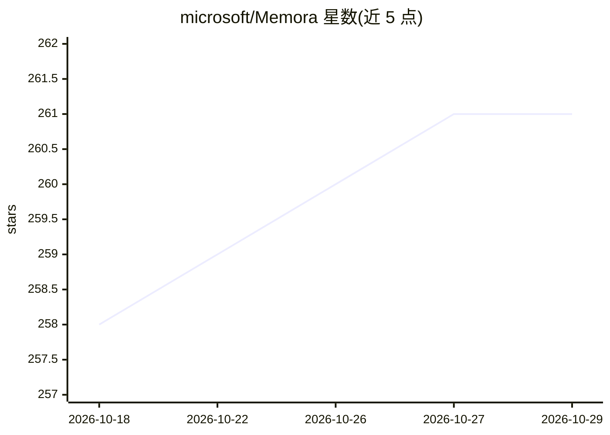

# microsoft/Memora

⭐ 261 · Python · MIT · 推送 2026-06-16 · [GitHub](https://github.com/microsoft/Memora) · 组织维护

**给 AI agent 的记忆管理框架：统一存储、组织与检索记忆**

Microsoft 开源的 agent 记忆管理库，配套论文。核心机制是调和式记忆表示：每条记忆含未索引的完整记忆值、被索引的一对一主抽象与多个线索锚点，将存储内容与组织访问方式分离。提供完整记忆生命周期：从对话/文档自动抽取事实与情节、存入 ChromaDB 向量库并去重合并、支持语义/Prompted/混合/GRPO（实验性）四种检索策略、将检索结果注入 LLM 提示生成回答。支持跨 agent 共享记忆空间与作用域隔离，LLM 接入配置支持 Azure OpenAI 与 OpenAI，另附 LoCoMo 与 LongMemEval 基准实验运行器。

## 筛选速览

| 维度 | 判定 | 备注 |
|---|---|---|
| AI 角色 | `ai-ecosystem` | LLM/agent 周边工具 |
| 许可风险 | `permissive` | MIT |
| 部署形态 | `library` | 以包/库形式分发 |
| 模型依赖 | locked-api |  |
| 硬件要求 | — | 无带数字的原话,不猜 |
| 安装摩擦 | `low` | 无编译、无系统依赖或容器化 |
| 成熟度 | `idea` | |

## 能力要点

- 记忆值不索引、主抽象与线索锚点索引的调和式记忆表示
- 记忆摄取→去重合并存储→四种检索策略→答案生成的完整生命周期
- 跨 agent 共享记忆空间与按角色隔离访问
- GRPO 强化学习检索策略训练（实验性，Qwen 3B/7B + LoRA）

## 适用场景

- 为我的 LLM agent 添加长期记忆与自动记忆管理
- 在多 agent 环境中共享和隔离记忆空间
- 复现 LoCoMo / LongMemEval 长期记忆基准实验

## 场景标签

`Agent 记忆` `RAG` · 领域:Agent 开发

## 证据(README 行号)

> L10: Memora is designed to take the headache out of agent memory. Instead of worrying about what and when to store memor
> L44: Memora provides a complete memory lifecycle for AI agents:

## 星数曲线

2026-10-18 258 → 2026-10-29 261（+3）

---
*卡片 v1 · prompt 1.4 · 生成 2026-10-22 · 置信度 mid · 依据 README sha `d0375791abe9` · [字段定义](../../DATASET.md)*
